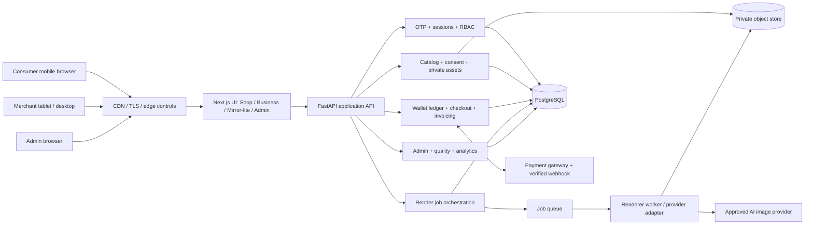

# Wearo.ai MVP — Backend specification

**wearo.ai | Engineering working spec v1.0 — 17 Oct 2026**

> This is an extracted developer view from the canonical `Wearo_MVP_Implementation_Spec_v1.0.md`; source is the uploaded MVP v1.0 and brand PDF. Do not add product WR IDs or expand FULL/BOUNDED pilot coverage. Proposed technology/contracts need approval under DEC-01..DEC-10.

## 1. Executive implementation contract

### 1.1 What the team will build

A single responsive web platform with three authenticated experiences and one optional guest storefront:

| Experience | Primary form factor | Identity and audience | Pilot outcome |
|---|---|---|---|
| **Wearo Shop** | Phone-friendly web | Guest browse; consumer phone OTP before wallet, render or saved content | Portrait + source garment -> consent -> price -> AI preview -> compare, zoom, feedback and repeat |
| **Wearo Business** | Desktop / tablet | Merchant owner email OTP | One boutique/jeweller tenant, up to 10–30 curated active pilot items, owner wallet, invoices, usage, one associate role |
| **Wearo Mirror-lite** | Tablet / desktop browser | Tenant associate email OTP; customer is a temporary, consented guest | Staff-guided garment or jewellery preview -> exact-item enquiry or finish and clear session |
| **Wearo Admin** | Desktop web | Separate administrator credentials + mandatory MFA | Tenant/entitlement, packs/pricing, approved model routing, audit/usage, dispute and operations |

**Shared platform:** One authentication policy layer, tenant/owner authorization, catalogue, private image workflow, render orchestration, prepaid **Wearo Token** ledger, payment confirmation, and auditable administration. Wearo Tokens are *published retail billing units*, not provider API input/output tokens.

### 1.2 Ship / do not ship boundary

**Ship:** guest exploration; phone OTP; email OTP; admin password+MFA; photo capture/upload with guidance and validation; affirmative consent; supported garment category configuration; one adult neutral mannequin; merchant photo/catalogue; static single-result rendering; original/product comparison and zoom; regeneration as separately disclosed billable action; basic feedback; necklaces/pendants and earrings behind fidelity gate; store sessions; opted-in enquiries; two token pack sizes; Indian gateway payment; business tax invoice; wallet histories/recredits; essential B2B metrics; admin model and tenant controls; deletion/support mechanisms.

**Do not ship:** native apps, 3D avatars, true fit measurement, AR/live video, stock sync, QR jewellery scanning, rings/bangles, custom blouse construction, tailor-ready Studio specs, inventory/branch hierarchy, AI wardrobe stylist, booking engine, subscription, provider fine-tuning UI, multi-country billing or public status portal.

**Category rollout is gated:** Wave 1 = approved clothing (initial Western shirts / T-shirts / tops and any individually approved kurta or curated saree slice). Wave 2 = approved necklace/pendant/earring products only if jewellery fidelity gate passes. The MVP PDF calls for selecting exactly 2–3 garment categories before launch; initial candidates are *not automatically approved*.

### 1.3 Normative and proposed language

- **SOURCE** = explicit function or boundary in either uploaded PDF; cited by original `WR-###`.
- **SPEC** = how engineering proposes to implement SOURCE, including interfaces and acceptance checks; changeable without renumbering WR.
- **DEC-XX** = unresolved product/operator decision that must be filled before production pilot. Values shown as examples are placeholders, **not commercial commitments**.
- **Must** in an implementation contract describes a proposed team-build condition. It does not upgrade a deferred source item into the MVP.

## 2. Engineering decisions and architecture baseline

### 2.1 Proposed stack (replaceable choices, not specified by the source PDFs)

| Concern | Proposed implementation | Why / replacement boundary |
|---|---|---|
| Responsive frontend | Next.js + React + TypeScript; shared accessible design-system package | Phone, tablet, desktop browser in one codebase; no native app |
| API and domain logic | Python FastAPI (typed Pydantic contracts); split into modules in one deployable modular monolith | Short MVP build cycle and useful Python AI-provider integration |
| Async processing | Managed job queue + separate Python worker | Renders and gateway callbacks must not block request threads |
| Transactional storage | PostgreSQL; row-level domain authorization enforced in code + tested tenant policies; optional DB RLS defense-in-depth | ACID wallet, idempotency and auditable ownership |
| Private objects | Object storage with server-generated private keys and short-lived signed access | Never expose permanent public customer-photo URLs |
| Cache / throttling | Redis or managed equivalent for OTP and burst controls | Rate limit, OTP lifecycle, short-lived session state |
| OTP providers | Replaceable Indian SMS provider and transactional email provider | No vendor selection is presumed |
| Payments | Replaceable Indian gateway adapter with signed webhooks and server verification | UPI/cards per enabled merchant account; no fabricated gateway claims |
| AI renderer | Provider adapter behind use-case routing, versioning, quality gates | Admin-approved model choice, no fine-tuning UI |
| Infra | One India-region deployment for pilot, TLS, managed secrets, encrypted storage and backups | India pilot simplification; confirm regulatory posture before launch |
| Instrumentation | Structured logs + trace IDs + product events + cost/usage aggregation | Traces for money, consent, quality and traction |

**Deployment separation:** `web` (public pages and SSR), `api` (privileged domain and identity), `worker` (expensive/private renders), `scheduler` (expiry/retention/reconciliation). These may share a source repository but **not** wallet or tenant authorization shortcuts.

### 2.2 Logical component diagram



### 2.3 Repository topology and responsibility boundaries

```text
wearo/
  apps/web/                 # Next.js: (shop), (business), (mirror), (admin)
  apps/api/                 # REST/OpenAPI endpoints, auth dependencies, validation
  apps/worker/              # provider adapters, asynchronous jobs, quality checks
  packages/ui/              # shared components and design token definitions
  packages/contracts/       # generated typed API client from openapi.yaml
  packages/config/          # non-secret shared offering/category vocabulary
  infrastructure/           # declarative infra, CI/CD, secret references
  specifications/           # THIS spec, openapi.yaml, traceability and test cases
  tests/                    # contract, security, e2e, quality golden set
```

**Service layer modules (BE-01…BE-11):** identity; tenant/roles; catalog; media+consent; rendering; wallet+pricing; payments+invoices; enquiries/store session; feedback/trust; admin+model; analytics+audit. No frontend or async worker may alter wallet balances directly.

## 3. Actors, security contexts and permissions

### 3.1 Principal types

| Principal | Context | Allowed | Never allowed |
|---|---|---|---|
| Guest | Anonymous browser, no private account | Discover enabled items, mannequin preview of *catalog samples* if policy allows, inspect limitations | Access wallet, purchased tokens, persistent personal results or paid render |
| Consumer | `principal_type=consumer` + verified phone | Own photo/results, pay/recredit, own wallet, delete/report, own enquiries | Read tenant inventory administration or others' photos |
| Merchant owner | `principal_type=business` + tenant + verified email | Manage own catalog and staff, top up tenant wallet, view invoices/usage, staff sessions as permitted | Select arbitrary paying tenant, access other tenants or admin APIs |
| Merchant associate | Tenant membership + verified email | View published tenant catalog, create/end guest sessions, render with tenant wallet, create consented enquiries | Change token packs/merchant billing, invite users, export other guest photos |
| Platform admin | Dedicated admin identity + MFA + scoped permissions | Manage tenant status, pricing/model configuration, reviewed cases and aggregate operations | Default access to consumer raw photos; ordinary store roles or wallet use |
| Async worker | Service identity + per-job scoped access | Read permitted job assets; write result; report status/cost | Read arbitrary tenants or publish assets without finalization |

### 3.2 Authorization invariant

Every resource request resolves an authenticated actor, **effective paying account**, and `tenant_id` or `consumer_id` on the server. Client-supplied `tenant_id`, `wallet_id` or `owner_id` is **never sufficient** authorization. Foreign IDs return a generic `404` or `403` without confirming private object existence. No cross-tenant query, download, signed URL, feedback, payment callback or object key access is acceptable (`WR-126`, `WR-152`, `WR-153`).

Use short-lived HTTP-only secure browser sessions and CSRF protection on cookie-auth mutations. OTP: hashed one-time challenges, max attempts, expiry, resend cap, destination rate limits and generic responses to prevent account enumeration. Admin: independent realm and MFA, no bypass via merchant auth.

### 3.3 Business wallet spending delegation

An associate spends the tenant wallet **only** on authorized in-store render actions. Ownership, pack pricing, invoices, staff invitations and model controls are owner/admin privileges. Each render records both `performed_by_principal_id` and `charged_account_id`.

## 6. Backend: domain model and storage contracts

### 6.1 Tenancy pattern

**Paying account abstraction:** `account {id, kind=CONSUMER|TENANT, owner_reference, status}`. Each has exactly one `wallet`. Consumers have personal `account_id`; businesses have tenant `account_id`; admin operations are not billable preview accounts. Every tenant-owned row carries `tenant_id` plus `account_id` if billable. Database policies and repository queries always scope by authorized account.

### 6.2 Core entity dictionary

| Entity (table) | Fields that must exist | Constraint / retention |
|---|---|---|
| `principals` | id, type, phone/email verified flag, status, created_at | unique normalized identity; no plain OTP data |
| `auth_challenges` | id, destination_hash, channel, code_hash, expires_at, attempts, resend_count, consumed_at | one-time, bounded life, hashed secret |
| `sessions` | id, principal_id, auth_realm, expires_at, revoked_at | server-invalidatable; separate admin realm |
| `business_tenants` | id, legal/trade name, business_type, state, invoice address, nullable GSTIN, status | unique slug, one pilot location only |
| `tenant_members` | tenant_id, principal_id, role=`OWNER|ASSOCIATE`, revoked_at | unique active membership, audited changes |
| `accounts` | id, kind, consumer_id XOR tenant_id, status | exactly one owner context per billable action |
| `offerings_entitlements` | account/tenant/category, enabled, effective times | only enabled categories shown/charged |
| `catalog_items` | id, tenant_id (nullable for central), code, type, title, original_image_key, attributes_json, merchant_url, status | per-tenant item code unique, no invented inventory |
| `category_quality_gates` | category, use_case, approval_status, review_version, enabled_at | no unapproved new jobs; jewellery initially disabled |
| `person_assets` | id, owner_account_id or guest_session_id, object_key, content_hash, mime, validation_state, delete_after | private, signed read, retention policy |
| `consents` | id, subject/session ref, actor, consent_version, purpose, permission_asserted, accepted_at | affirmative, immutable evidence without needlessly storing photo |
| `guest_store_sessions` | id, tenant_id, associate_id, state, expires_at, finished_at | temporary, cannot resume after finish |
| `render_jobs` | id, owner_account_id, tenant_id nullable, session_id nullable, item_id/source_asset_id, person_asset_id, quote_id, provider_model_version, status, cost_tokens, idempotency_key, error_code, created_at | per-account unique idempotency key; full status audit |
| `render_results` | job_id, private_object_key, generated_at, disclosure_version, validation_result | accessible only to authorized owner/active guest session |
| `feedback_reports` | id, job_id, kind, reason, actor, removal_status, created_at | moderation workflow, no unconsented sharing |
| `wallets` | id, account_id, currency_units=`WEARO_TOKEN`, version | unique owner account |
| `wallet_ledger` | id, wallet_id, type, amount_signed, related_payment/job, created_at, idempotency_ref | append-only; no arbitrary overwrite |
| `wallet_reservations` | id, wallet_id, render_job_id, amount, promo_allocation, status, expires_at | one active reservation/job, atomic settlement |
| `wallet_credit_lots` | id, wallet_id, purchased_or_promo, quantity, remaining, expiry | separate promo from purchased, deterministic spend priority |
| `token_price_versions` | id, action, category, price_tokens, effective_from/to, active | price quoted/locked by version |
| `token_packs` | id, audience, token_quantity, base_price_inr, discount_inr, final_price_inr, effective_from/to, status | B2C/B2B identical *policy*, published pack availability |
| `payment_orders` | id, owner_account_id, provider_order_id, pack_id, amount, currency, state, idempotency_key | unique provider order/event refs |
| `payment_events` | provider_event_id, type, verified_at, raw_hash, handled_at | unique webhook id; no duplicate credit |
| `invoices` | id, payment_id, sequential_invoice_number, invoice_snapshot_json, tax_snapshot_json, pdf_object_key | immutable after issue; legally reviewed template |
| `enquiries` | id, tenant_id, session_id, catalog_item_id, contact_channel, contact_encrypted, contact_consent_at, state | exact item and opt-in; no appointment engine |
| `privacy_requests` | id, actor/account_ref, type, submitted_at, state, resolved_at | manual traceable handling |
| `support_cases` | id, actor, job/payment ref, reason, state, resolution | audit adjustment references |
| `model_registry` | id, provider, version, use_case, capability, approved, enabled, allowed_segments | active allowed version only |
| `model_routes` | use_case, category, version_id, effective_from, changed_by | version captured per job |
| `audit_events` | id, actor, action, entity, entity_id, timestamp, request_id, reason, metadata_redacted | access-controlled, append-only |
| `analytics_events` | id, occurred_at, actor_segment, event_name, anonymous_dimensions | no images/contact PII |

**Storage safety:** Blob keys must be opaque. Never log access tokens, OTP codes, image URLs, contact details or generated facial content. Database backups inherit restricted access/retention and restore procedures. Implement a scheduled deletion job, verifiable deletion statuses and revoked signing capability. Historical tax invoices and minimum lawful financial records must be retained according to counsel-approved rules; do not delete financial evidence merely because an image is deleted.

### 6.3 Suggested indexes and transaction boundaries

- Unique `render_jobs(owner_account_id,idempotency_key)`, `payment_events(provider_event_id)`, `payment_orders(provider_order_id)`, `wallets(account_id)`, active tenant membership and invoices by invoice number.
- Scope indexes `catalog_items(tenant_id,status,category)`, `render_jobs(owner_account_id,created_at DESC)`, `enquiries(tenant_id,created_at DESC)` and ledger by wallet/time.
- Wallet reserve/settle/release must lock wallet balance or use serializable transaction / atomic conditional write. A positive ledger row can never be created without a signed legitimate payment, authorized promo grant or auditable reversal.
- Database writes (status change + debit ledger + reservation finalization) commit atomically. Notifications/event delivery use **transactional outbox** or equally safe replayable mechanism.

## 7. Backend: APIs and contracts

### 7.1 API conventions

- Root: `/api/v1`; HTTPS only; JSON in/out except `POST /assets/upload-intents` and signed object-store transfer. `Idempotency-Key` required on token spend, payment-order creation, and write actions vulnerable to replay.
- Authentication: secure HTTP-only browser cookie with CSRF on state changes (OpenAPI defines cookie-based sessions and an anti-CSRF header on protected mutations; provider webhooks use signature verification).
- Every write returns `request_id`; background actions respond `202` with resource ID/status URL; standard errors use `{code,message,request_id,details?}`. Never expose private existence or internal provider prompt/logs.
- Pagination: `limit`, opaque `cursor`; timestamps UTC ISO 8601; amounts in integer INR minor units (`paise`) and integer Wearo Tokens; never floating point money.
- `403`: authenticated but not authorized; `404`: unknown or tenant-hidden; `409`: version/idempotency conflict; `422`: validation/unsupported category; `429`: throttled; `503`: provider unavailable.

### 7.2 Endpoint inventory (proposed contract surface)

| API group | Endpoint | Permission | BE acceptance |
|---|---|---|---|
| Identity | `POST /auth/phone-otp/request`, `/verify` | Public OTP throttle | Valid verify -> consumer session; resend/expiry/attempt policy |
| Identity | `POST /auth/email-otp/request`, `/verify` | Public OTP throttle | Owner/associate context from verified email; no rogue tenant context |
| Admin identity | `POST /admin/auth/login`, `/admin/auth/mfa/verify` | Admin realm | Password alone never creates active admin session |
| Session | `GET /me`, `POST /auth/logout` | Session | Identity and entitled account metadata; revoke |
| Public catalog | `GET /categories`, `GET /catalog/items`, `GET /catalog/items/{id}` | Guest/entitled filter | Quality gate + unpublish filter + source image trace |
| Asset validation | `POST /assets/upload-intents`, `POST /assets/{id}/validate` | Owner or scoped guest session | Private upload, type/size, pose/content validation |
| Consent | `POST /consents` | Consumer/temporary guest | Versioned affirmative record before processing |
| Pricing | `POST /quotes`, `GET /quotes/{id}` | Verified account or scoped store session | Correct price-version, wallet and expiry; no charge |
| Rendering | `POST /renders`, `GET /renders/{id}`, `GET /renders` | Account owner / authorized staff | Idempotent reserve/queue/settle, private access and errors |
| Result | `GET /renders/{id}/assets`, `DELETE /renders/{id}` | Owner or active store session | Short-lived signed original/result URLs and deletion |
| Feedback | `POST /renders/{id}/feedback`, `/report` | Owner or active store session | Reason-coded feedback and complaint/remove |
| Wallet | `GET /wallet`, `GET /wallet/transactions` | Paying context | Consistent purchased/promo/reserved/available balance |
| Packs | `GET /token-packs` | Consumer/owner | Both audience packs, published discount, effective dates |
| Payments | `POST /payment-orders`, `GET /payment-orders/{id}` | Consumer/owner | Create gateway order only; confirm credits on verified server event |
| Gateway | `POST /webhooks/payments` | Gateway signature | Replay-safe credit once, ledger/invoice reconciliation |
| Invoice | `GET /business/invoices`, `GET /business/invoices/{id}` | Owner scoped to tenant | Correct business invoice and controlled download |
| Business | `POST /business/tenants`, `GET/PATCH /business/tenant` | Verified owner | Minimal Indian invoice fields, optional GSTIN |
| Staff | `POST /business/staff/invitations`, `DELETE /business/staff/{memberId}` | Owner | Invite/revoke with role and audit |
| Catalog edit | `POST /business/catalog/items`, `PATCH .../{id}`, `DELETE .../{id}` | Owner | Real SKU, images, publish/unpublish; no stock sync |
| Sessions | `POST /business/store-sessions`, `GET .../{id}`, `POST .../{id}/finish` | Associate/owner | Private temporary session, expiry, cleanup |
| Enquiries | `POST /business/store-sessions/{id}/enquiries`, `GET /business/enquiries` | Associate/write; owner/read | Explicit contact opt-in + exact catalog item |
| Metrics | `GET /business/overview` | Owner | Sessions, renders, selected items, opted-in enquiry counts |
| Privacy | `POST /privacy-requests`, `GET /privacy-requests/{id}` | Owner/consumer | Traceable manual state |
| Support | `POST /support/cases`, `GET /support/cases/{id}` | Owner/consumer | Issue ref/status, manual review |
| Admin ops | `GET /admin/overview`, `GET /admin/tenants`, `PATCH /admin/tenants/{id}` | Admin MFA | Segment filters, reason, entitlements/audit |
| Admin pricing | `GET/POST /admin/token-packs`, `PATCH /admin/token-packs/{id}` | Pricing admin | Effective-dated pack change, no retroactive repricing |
| Admin AI | `GET /admin/models`, `PATCH /admin/model-routes/{useCase}` | AI admin | Approved version only; audit and category disable |
| Admin cases | `GET/PATCH /admin/cases/{id}`, `GET /admin/audit` | Scoped admin | Resolution/audit and no raw customer photos by default |

`openapi.yaml` in the accompanying SDD package supplies illustrative wire schemas and examples; this inventory controls scope if draft schema shortcuts exist.

### 7.3 Key request/response examples

**Request: quote a single approved render (no debit)**

```json
POST /api/v1/quotes
{
  "use_case": "GARMENT_TRYON",
  "catalog_item_id": "itm_123",
  "person_asset_id": "ast_456",
  "consent_id": "con_789",
  "store_session_id": null
}
```

```json
200 OK
{
  "quote_id": "quo_001",
  "action": "GARMENT_TRYON",
  "cost_wearo_tokens": 5,
  "available_wearo_tokens": 20,
  "price_version": "price_2026_01",
  "expires_at": "2026-10-17T08:15:00Z",
  "disclaimer": "AI visual preview only; fit, size and drape not guaranteed."
}
```

**The values 5 / 20 and expiry above are API examples only; DEC-03/04 must approve actual values.**

**Request: commit user-approved render**

```json
POST /api/v1/renders
Idempotency-Key: <stable-client-generated-uuid>
{
  "quote_id": "quo_001",
  "approved_cost_wearo_tokens": 5
}
```

```json
202 Accepted
{
  "render_id": "rnd_002",
  "status": "QUEUED",
  "status_url": "/api/v1/renders/rnd_002"
}
```

**Job status** returns `QUEUED|PROCESSING|QUALITY_CHECK|SUCCEEDED|FAILED|CANCELLED`; on success it includes result metadata and `charge_status=SETTLED`. On failure `charge_status=RELEASED|RECREDITED` and a safe recovery message; do not expose a “not charged” claim while funds reconciliation is incomplete.

**Error envelope**

```json
{
  "code": "UNSUPPORTED_CATEGORY",
  "message": "This item cannot be previewed yet. Choose an enabled category.",
  "request_id": "req_abc",
  "details": {"category": "BANGLE"}
}
```

### 7.4 API contract test rules

For each mutating path, generate valid, unauthenticated, wrong-tenant, missing-consent, expired-OTP/quote, duplicated-idempotency, rate-limit, invalid input and 5xx provider fault tests where meaningful. Maintain typed clients generated from checked-in `openapi.yaml`, and fail CI on contract drift. No endpoint accepts raw uncontrolled object-store path or provider URL from clients.

## 8. Backend workflows and state transitions

### BE-01 / OTP and account lifecycle

`OTP_REQUESTED -> SENT -> VERIFIED | EXPIRED | BLOCKED`; OTP consumed on success, single-use, generation-specific and rate limited per identity/device/IP. Merchant account creation only after verified email. Revoked staff membership invalidates authorization even if a browser session remains valid. Admin realm has separate password/MFA and brute force protections. Password reset and recovery must follow established controls before public launch; not a consumer sign-in feature.

### BE-02 / Image validation and consent pipeline

1. `upload-intents` returns short-lived scoped write; uploads land private and quarantined.
2. Check MIME by **bytes**, size/pixels, malware and safe supported content. Check single person / pose / crop / lighting where applicable. Image processing must operate inside a permitted region/provider under disclosed policy.
3. Reject unusable assets **before quote/reservation** with actionable error codes: `POOR_LIGHT`, `MULTIPLE_PEOPLE`, `CROPPED_SUBJECT`, `UNSUPPORTED_FILE`, `UNSUPPORTED_CATEGORY`.
4. Check consent `accepted=true`, correct version, actor authorization, permitted use, date and still-active merchant session.
5. Personal images are never silently used to train a model. Source-proposed policy is **no default training and no training opt-in UI in MVP**. Provider data retention/training terms require contract review.
6. Delete/expire photos and derived thumbnails with an auditable async cleanup record; stale assets fail read even while bytes await purge.

**Age control:** initial pilot may be **adults-only** if approved by DEC-06; UI and backend must block unsupported minor image submissions. No claim that a guardian consent solution already exists.

### BE-03 / Render job machine and compensation

```mermaid
stateDiagram-v2
  [*] --> PREFLIGHT
  PREFLIGHT --> REJECTED: invalid photo/category/consent
  PREFLIGHT --> RESERVED: price current, wallet sufficient, approval
  RESERVED --> QUEUED: persist job + queue outbox
  QUEUED --> PROCESSING: worker claims lease
  PROCESSING --> QUALITY_CHECK: provider produced asset
  QUALITY_CHECK --> SUCCEEDED: approved; atomic debit + release reservation
  QUEUED --> FAILED: exhausted retries
  PROCESSING --> FAILED: provider error / timeout
  QUALITY_CHECK --> FAILED: material fidelity violation
  RESERVED --> CANCELLED: cancelled before processing
  FAILED --> [*]: release reservation / recredit if needed
  CANCELLED --> [*]: release reservation
  SUCCEEDED --> [*]: result labelled + private access
  REJECTED --> [*]: no reserve / no charge
```



**Algorithm:** ensure unique `(paying_account,idempotency_key)` before any reserve; verify quote item/asset/account and expiry, category enabled, approved model route, consent and sufficient balance. Create job+reservation in one transaction, enqueue via outbox, return canonical job. Worker revalidates effective permissions/disable policy, uses recorded model version and tracks provider invocation. Persist result privately; quality check must pass; atomically insert one debit ledger entry, settle reservation, and mark `SUCCEEDED`; expose result after commit. Failure or unacceptable output releases held tokens. A retry with same key returns same job; a deliberate regeneration uses a **new quote + new key**.

**Pilot quality gate:** curated golden set per enabled garment/jewellery category; reviewers explicitly check face/skin/hair/apparent proportions, original product color/print/cut, and stone/design details. Reject material distortion. Do not claim calibrated sizing, gold purity/weight, real drape, inventory or guaranteed match. Automated heuristics can assist but must not replace early human review.

### BE-04 / Money, packs and ledger invariants

- `Wearo Tokens` integer pricing per successfully delivered action; provider LLM/image inference token count is an internal **cost** metric only.
- Wallet book = append-only `CREDIT_PURCHASED`, `CREDIT_PROMO`, `DEBIT_RENDER`, `REVERSAL`, `ADJUSTMENT` entries; holds tracked separately as reservations, not as irreversible spend.
- Available = unexpired purchased/promo available credits **less active holds**. Consumption order (promo vs purchased) and expiry rules must be published in DEC-03; report remaining promo separately (`WR-167`).
- Each successful paid render creates **exactly one** charge; failing or non-delivered requests leave **zero net debit** (`WR-128`, `WR-160/161`). No wallet goes negative; transaction counts remain consistent under concurrent associates.
- Gateway redirects are UI-only. Payment confirmation is a verified signed server callback and/or server-side provider status query. Provider `payment_id/event_id` unique; duplicate webhook yields no second tokens.
- Standard pack and **larger discounted pack** presented to B2C and B2B; show number of tokens, undiscounted price, savings, payable amount, GST/tax handling where applicable, effective prices and invoice fields. Keep immutable purchase snapshot.
- Invoice issued to correct confirmed paying legal person / business with appropriate numbering, date and tax details after local tax review; do not invent tax rates/exemptions. Refunds reconciled to original payment and ledger via auditable process.
- Reconciliation job detects `gateway confirmed / wallet missing`, `wallet credit without paid confirmation`, `invoice mismatch` and unsettled reservations. Escalate and block misleading financial displays until resolved.

### BE-05 / Merchant catalogue / jewellery quality

Owner may add/update/unpublish a limited set of genuine SKU records with original image, item code/name, type, known specifications, optional original seller link and status. The merchant must attest rights to use those source images; variants must be real catalog items. Only enabled category + approved image fidelity + published item can be rendered. Necklace and earring placement is **approximate**. Do not infer gold weight, dimension, stone grade, guaranteed fit or live stock. If seller URL not verified, show an enquiry rather than purchase link.

### BE-06 / Guest store session and enquiry

`CREATED -> ACTIVE -> FINISHED|EXPIRED`. Session stores tenant, associate, time, consent and a restricted person asset pointer. Association of item and render to session is immutable. On finish/expiry: revoke authorization and all server-issued photo/result links; tell UI to clear state and disable browser back reuse; queue deletion by approved retention policy. An enquiry **must** contain `catalog_item_id`, destination tenant, explicit contact-sharing consent and minimal encrypted callback information; no sharing to another retailer. Acknowledgment states the exact item, merchant and follow-up (no promised appointment slot).

### BE-07 / Administration and controls

Sensitive mutations require role check, MFA and `reason`, captured with actor/action/target/time/before-after summary. `model_registry` cannot route disabled/unapproved versions; effective-date rules prevent silently repricing already-issued quotes or purchases. Admin console initially aggregates usage and anonymous quality outcomes; access to images is not required for general admin reporting. Support/privacy cases track submitted/open/in-progress/resolved; manual wallet corrections include case, approver and compensating ledger event.

### BE-08 / Privacy and security guardrails

Data minimization by default. Signed GET/PUT URLs short-lived and scoped; store plain contact only encrypted. Encrypt transit and storage; secrets in managed store; CSP, CSRF, XSS and upload security; provider prompt injection controls on item captions and upload metadata. Security test tenant isolation with altered route/query/path IDs, support impersonation attempts, reused OTP, stolen signed links and session replay. Do not persist guest assets in browser caches or analytics. Log only stable pseudonymous IDs; no image bytes/OTP. Implement consent withdrawal/deletion with explicit handling of ongoing jobs and money settlement. Publish privacy/support policy with reviewed retention values.

## 9. AI model contract and quality evaluation

### 9.1 Rendering provider adapter

```python
class ImageTryOnAdapter(Protocol):
    async def render(self, *, person_private_ref: str,
                     product_private_ref: str, category: str,
                     consent_scope: str, model_version: str,
                     request_id: str) -> RenderProviderResult: ...
```

The adapter operates on private server-side references and returns a **private** asset + metadata (elapsed time, provider charge, version, moderation/quality status). It never sees a wallet ID as authority, and cannot mutate token balances. Prompts are versioned centrally, include product-identity instructions and never permit unsafe face swaps/identity distortion. Different approved renderers can be routed by garment vs jewellery if validation supports it; the platform is not tied to one model.

### 9.2 Golden dataset contract

Create a **consented, rights-cleared pilot golden set** with controlled portraits/mannequins, one category/product original photo per case, and explicit expected preserve/reject criteria. Include representative skin tones, hair, lighting, necklines, clothing colors/prints, borders, necklace stone arrangements and earring symmetry. Ground-truth quality review is categorical, not an unsubstantiated claim of pixel-perfect match.

| Quality dimension | Review question | Failure action |
|---|---|---|
| Person identity | Face/skin/hair/broad proportions/background materially preserved? | Reject output and investigate identity drift |
| Apparel identity | Same selected product color, print, visible borders, cut/neckline? | Category/product disabled when repeated |
| Jewellery identity | Same recognisable shape, gold tone, visible stone layout? | Do not launch affected SKU/category |
| Placement honesty | Appears plausible but not claimed to be measured size or weight? | Label clearly, prevent precision claims |
| Delivery reliability | Completed result with correct original/source and payment settlement? | Block rollout on repeat delivery/payment failure |
| Security/privacy | Consent, ownership, no raw photo leakage, expiry? | Immediate launch blocker |

The **MVP traction PDF** proposes at least **85% delivered success** on eligible requests and **75% positive usefulness feedback**; these are experimental targets, not a guarantee of photorealism. Product/category release requires no repeated *material* design or identity distortion and zero unresolved double charges/tenant leaks. Track failure reasons by version/category, then review weekly.

## 10. Events, analytics, operations and cost

### 10.1 Proposed event vocabulary (non-PII)

`shop_viewed`, `category_selected`, `photo_validation_failed`, `consent_accepted`, `otp_verified`, `quote_viewed`, `render_requested`, `render_succeeded`, `render_failed`, `wallet_topup_started`, `wallet_topup_confirmed`, `result_feedback`, `result_repeated`, `store_session_started`, `store_session_finished`, `item_selected`, `enquiry_opted_in`, `merchant_pack_replenished`, `image_removed`, `tenant_suspended`, `model_route_changed`.

Events include pseudonymous `account_id/tenant_id`, category, price version, job/status IDs and timestamps; **exclude** photo data, image URL, phone, email and OTP. Cross-service correlation uses request/job ID. Never infer purchase from a generated image or enquiry unless a real confirmation exists.

### 10.2 Core pilot funnel and exact denominators

**B2C paid conversion:** distinct verified promotional-preview users who make a **first real-money pack purchase within 14 days** / distinct verified users with a delivered introductory preview. Suggested signal: >=5%. **B2C repeat:** >=20% request a repeat render. 250–400 adult shoppers, 4–6 weeks.

**Merchant weekly active:** store performs >=1 real staff-led try-on in a week. Suggested >=50% weekly active among onboarded shops. Merchant paid continuation = second paid pack or agreed paid 30-day follow-on / active pilot merchants; suggested >=25% among jewellery cohort. Pilot: 4–6 jewellers and 4–6 boutiques, ~10–30 curated SKUs each.

**Unit economics per paid successful render:** recognize realized attributable Wearo Token revenue **less** provider/image API cost, payment fees and recredit-related cost. Measure B2C and each B2B vertical separately. Gross image volume alone is not a GO criterion.

### 10.3 Observability and runbooks

Metrics: render queued/processing duration, success/failure by category/model, quote-to-success conversion, incomplete/reserved wallet holds, webhook retries, payment vs ledger mismatch, API 401/403/429, image validation rejection, consent completion and object deletion backlog. Alert on duplicate ledger anomaly, tenant-access violation, provider-cost spike, old reservations, webhooks failing signature and guest cleanup backlog. Runbooks: pause category/model, hold new paid renders, replay signed webhook safely, re-run reconciliation, revoke session, issue audited financial reversal and explain user-facing status.

### 10.4 Nonfunctional verification targets (proposed DEC-09)

- Core UI navigable at 360 px phone, 768 px tablet, desktop; money/consent without horizontal overflow.
- Standard non-render API p95 target **< 800 ms** in normal pilot load excluding provider calls; actual capacity and latency to be measured.
- Async render progress and polling must handle minutes-long provider delays without HTTP timeout or duplicate debit; published timeout and refund rule required.
- One provider/model failure may not leave a wallet hold indefinitely; cleanup/reconciliation job must converge.
- All sensitive endpoints require authorization/tenant isolation and server-side input validation; CI includes OWASP-focused checks and dependency scanning.
- Daily backup/restore drill and disaster procedures sized to the pilot; no unreviewed absolute uptime promise.

## 11. Contract-first test scenarios (Given / When / Then)

| QA ID | Given / When | Then / required proof | Trace |
|---|---|---|---|
| QA-001 | Guest opens mobile Shop and picks enabled product | Can browse; paid render prompts phone OTP; no account data exposed | WR-001,002,142 |
| QA-002 | Upload poor-light/cropped/multi-person image | Actionable rejection **before** any reservation/debit | WR-003,004 |
| QA-003 | Personal image, consent unchecked or permission false | Render quote rejected; no provider invocation | WR-006,124,125 |
| QA-004 | Unsupported garment or disabled jewellery category | Not offered/charged; safe reason displayed | WR-014,015,043,075,076 |
| QA-005 | Verified shopper approves fixed-price quote | Single render status chain, original + AI label + fit limitation + zoom | WR-024–030,120,121 |
| QA-006 | Same render POST retried 10 times with identical key | One canonical job, one reservation, one final debit | WR-160 |
| QA-007 | Two associates draw on the same low-balance tenant wallet | At most available amount reserved; no negative balance/double spend | WR-153,157,160 |
| QA-008 | Model timeout, invalid output or job failure | No net token cost, safe retry and refund/release visible | WR-040,128,161 |
| QA-009 | Duplicate/late gateway webhooks arrive | Tokens credited exactly once after verification; failed payment never credits | WR-162,170,173 |
| QA-010 | Buyer selects standard vs bulk pack | Base, savings, total, tokens and purchase confirmation match immutable price version | WR-158,159,163 |
| QA-011 | Business owner onboards in India | Email OTP, one tenant, optional GSTIN, proper issued invoice available | WR-144–149,172 |
| QA-012 | Owner revokes associate | Associate immediately loses merchant session/catalog spend; owner retains control | WR-150,152 |
| QA-013 | Tenant A guesses tenant B's item/render/wallet/invoice IDs | No content, balance, image URL, usage or tenant existence leaked | WR-126,152,153,187 |
| QA-014 | Showroom customer finishes; next customer uses Back/Reload/old URL | Prior photo/result hidden and unresolvable, cleanup scheduled | WR-086,089,093,123 |
| QA-015 | Customer opts in enquiry with exact item and phone | Enquiry shown to correct merchant; receipt names item and next follow-up | WR-084,092,113,119 |
| QA-016 | User reports/removes preview | Report tied to result; private asset unavailable on deletion; complaint tracked | WR-122,127,188,193 |
| QA-017 | Admin toggles category/model, pack price and tenant with reason | Only approved routes used for new jobs, effective dates honored, audit written | WR-177,178,181,182,189 |
| QA-018 | Consumer tries using merchant owner credentials in admin login | Denied; admin password+MFA separate; audit and throttling operate | WR-175,192 |
| QA-019 | Product has no verified seller URL | Enquiry, not invented Buy button/checkout; source item always accessible | WR-017,079,110 |
| QA-020 | Jewellery result fabricates stones/changes shape in quality review | Reject/not release affected output; disable item/category pending fidelity review | WR-026,076,083 |
| QA-021 | Guest consented image reaches TTL / owner deletes | Revoke access immediately, remove object asynchronously, preserve legally necessary audit only | WR-122,123,130,187,188 |
| QA-022 | B2C promo credit issued once | Purchased/promo balances and validity distinct; no duplicate promo on repeat OTP | WR-165,167 |
| QA-023 | Admin reports use B2C/B2B filter and date range | Totals reconcile with underlying jobs/payments/ledger, no real customer photo | WR-096,176 |
| QA-024 | Long provider outage during quoted/held render | User sees progress -> failure and funds restored, no orphaned reservation | WR-161,191 |
| QA-025 | UI tested in phone/tablet/desktop and keyboard/screenreader | Main actions accessible; selection/errors not color-only; dark Mirror contrast checked | WR-011,135 |
| QA-026 | Customer chooses neutral adult mannequin instead of own photo | Renderable only for supported categories; no avatar customization or personal consent bypass | WR-007 |
| QA-027 | Signed-in customer opens/deletes recent results | Only own delivered recent previews listed and removed; no mood boards | WR-010 |
| QA-028 | User uploads one valid product reference instead of SKU | Product clearly labelled as nonmerchant concept, supported category only | WR-013 |
| QA-029 | Merchant owner adds, updates, unpublishes 10–30 real pilot products | Published display follows tenant ownership, no inventory/branch sync | WR-020 |
| QA-030 | Shop displays retailer-listed product beside AI render | Source product and generated illustration unmistakably distinguished | WR-021 |
| QA-031 | Shopper presses thumbs down with wrong-color reason | Feedback attached to correct render without exposing private result | WR-039 |
| QA-032 | Jewellery item with merchant dimensions visualized | UI says approximate dimensions, never asserts calibrated scale or gold weight | WR-077 |
| QA-033 | Wallet has promo/paid balance and insufficient funds | Price, spendable balance and top-up guidance visible; no negative spend | WR-129,166 |
| QA-034 | Account switches among entitled offerings/form factors | One core billing/identity, separate B2C/B2B shells, disabled features hidden and blocked | WR-133,134,136 |
| QA-035 | OTP expired, guessed, resent too frequently or used twice | Login fails safely, limits enforced, legitimate new challenge can verify | WR-140,141 |
| QA-036 | Payment checkout offers provider-enabled India rails | Actual enabled UPI/card options visible; unavailable rails not falsely promised | WR-171 |

**Quality gate for all tests:** unit test, API contract, integration against test PostgreSQL/queue/store, browser E2E, negative authorization tests, and representative photo/golden evaluation. Payment provider sandbox != completed live payment approval.

## 12. Spec-driven delivery sequence, source control and handoffs

### 12.1 Work breakdown with dependencies

| Sprint slice | Frontend deliverable | Backend deliverable | Evidence / unlock |
|---|---|---|---|
| **S0 / Spec freeze** | Approved route map, brand tokens, wireframes and error states | OpenAPI baseline, schema migrations, security decisions, gateway/provider shortlist | DEC choices recorded, 90 trace rows mapped; no coding from unresolved semantics |
| **S1 / Secure foundation** | Shells, phone/email OTP, business onboarding, admin MFA | Principals, tenants, RBAC, OTP/rate limiting, audit and private upload pipeline | QA-001, 002, 003, 011, 012, 013, 018 |
| **S2 / Catalog and single render** | Consumer selection, upload, consent, quote, polling, comparison | Catalog, enabled categories, model registry/adapter, render queue and quality gate | QA-004, 005, 019, 020, 025 |
| **S3 / Money and trust** | Pack checkout, balance/history, result report/delete/retry | Ledger, holds, provider callbacks, invoicing, retention, refunds, support | QA-006–010, 016, 021, 022, 024 |
| **S4 / Merchant pilot** | Owner catalog/usage, Mirror-lite guided tablet flow, enquiries | Temporary guest session, tenant wallet delegation, enquiry/aggregate analytics | QA-014, 015, 023; boutique pilot enabled |
| **S5 / Jewellery gate & pilot** | Jewellery item details, source/preview controls | Golden dataset gate, category enablement, admin monitoring and cost metrics | Verified jewellery fidelity or vertical stays disabled |

**Critical path:** auth & tenancy -> private uploads/consent -> approved category/model + catalog -> quotes -> exactly-once ledger & payment -> successful render and replay safety -> guest showroom -> pilot acceptance. A mocked render can be used for contract/UI tests but **cannot** count as passing real visual fidelity/traction.

### 12.2 Story / PR spec template

Every coding story carries: `Story ID`, **source WR-IDs**, `FULL|BOUNDED treatment`, impacted FE-S/BE/API modules, typed input/output contract, behavior transitions, threat/PII review, migration impact, observability, test IDs, non-goals, review screenshots (3 breakpoints if UI), and precise acceptance proof. PR is not complete if a changed API is not reflected in OpenAPI or if a selected WR acceptance test is missing.

**Example:** `STORY-RENDER-001` -> `WR-024,027,028,128,158,160,161` -> quote/create/status/result interfaces -> idempotent reservation and settle -> result source+AI label -> QA-005/006/008 -> reject unsupported items before debit.

### 12.3 Release environment and pipeline

`local` -> `test` -> `staging` -> `pilot-prod`. CI: lint/typecheck, unit tests, OpenAPI lint and generated client drift, schema migration rehearsal, contract tests, SAST/dependency scan, tenant authorization tests, payment replay concurrency test, E2E responsive visual snapshots, golden-set evaluation summary. CD uses masked secrets and staggered deploy: migrate compatible DB -> deploy API/worker -> web -> smoke -> enable via entitlement flags. Every model route and token price change has an audit and safe rollback.

## 13. Release acceptance checklist and decisions

### 13.1 Mandatory pilot release gates

- **Coverage:** All 90 selected WR records in the trace matrix are assigned an owner and a pass/fail test. FULL retains master expected outcome; BOUNDED satisfies **only** the limited pilot treatment; all 107 unselected WR remain out of release scope.
- **Consumer end-to-end:** an adult user can get a legitimate delivered paid render on mobile; original person/item + AI disclosure, feedback, recover and delete work.
- **Merchant end-to-end:** real merchant can self-register, verify, upload genuine inventory, invite associate, buy pack, view invoice/usage; associate runs private session and consented enquiry, clears next guest.
- **Money:** duplicate gateway callbacks, concurrent wallet use, refresh, retries and failures create no unexplained double charge, orphan hold or wrong account credit.
- **Trust:** adult/permission policy, explicit consent, tenant isolation, data retention/deletion and no default model training are verified; admin password+MFA is separate.
- **Quality:** category-specific golden review passes; materially fabricated jewellery or garment and repeated face distortion stop that category; no false exact fit/weight/stock claims.
- **Traction:** B2C paid conversion and merchant paid continuation by vertical are measurable from real payments; no conversion claim from free credits.

### 13.2 Required decisions before engineers freeze configuration

| Decision | Who signs off | Effect / current safe stance |
|---|---|---|
| **DEC-01** First 2–3 clothing categories | Product + AI quality lead | Candidate shirts/T-shirts/tops and separately tested kurta/saree; no automatic broad eligibility |
| **DEC-02** Jewellery go/no-go and representative golden set | Merchant pilot + AI lead | Necklaces/earrings **off** until fidelity confirmed; boutiques can lead if fails |
| **DEC-03** Standard/discounted pack, per-action tokens, promo rule and expiry | Product/Finance | Values **TBD**; example API numbers not prices; same pricing policy B2C/B2B |
| **DEC-04** Personal result / temporary store image retention duration and TTL | Privacy/Product | Values **TBD**; revoke session immediately and purge per published schedule |
| **DEC-05** India payment and OTP providers, business invoicing/GST review | Finance/Legal/Engineering | No vendor chosen or tax percentage invented; webhook verified |
| **DEC-06** Adult-only pilot policy and identity/age confirmation approach | Legal/Product | Safe restriction of unsupported minors pending compliant route |
| **DEC-07** Rendering provider, region/data processing terms and pricing | AI/Security | Approved per category and version; no automatic customer-photo training |
| **DEC-08** Product quality thresholds and human review sampling | Product/AI/Merchant | Material fidelity/identity hard stop regardless of good aggregate score |
| **DEC-09** Latency, quota, timeout, rate limits and incident ownership | Engineering/Ops | Proposed p95 and retry values require load/provider baseline |
| **DEC-10** Final font, mobile typography and any production logo assets | Design | Brand PDF locks color roles but does not fix a full typography implementation |

### 13.3 Source references and precedence

- **MVP source:** *Wearo AI MVP Product and Platform Requirements v1.0*, 18 pages. Sections 1–5 scope and gates; pages 7–15 the complete 90-identifier mapping; page 16 traction; page 18 sync protocol.
- **Brand source:** *Wearo AI Brand Colours and UI Guidelines v1.0*, 6 pages. Page 2 all primary colours; page 3 mobile/light Shop; page 4 dark tablet Mirror/Studio; page 5 neutral Business/Admin; page 6 exact implementation tokens and contrast guidance.
- **Master version:** Master Product and Platform Requirements v3.0 is referenced by the MVP PDF, but was **not separately attached in this request**. Master wording/acceptance in the traceability appendix is copied from the provided MVP PDF, not independently reconciled with the full master document.

**Change-control rule:** If a truly new product behavior is requested, edit/version **Master v3.0** and its MVP overlay first, then modify this implementation spec. Do not silently insert a new WR ID or mark a BOUNDED residual as done.

---

