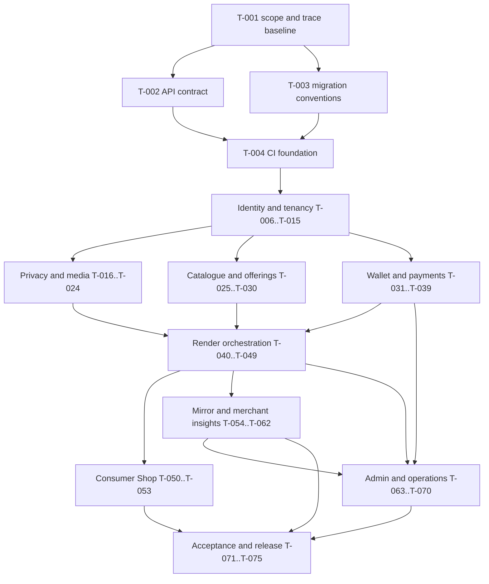

# Wearo.ai MVP task dependencies and traceability

## Dependency-first execution graph

The graph is intentionally domain- and invariant-first. UI assembly begins only after its identity, authorization, data, money, and workflow contracts exist. Within each section, the exact task-level `Dependencies` column in `TASKS.md` is authoritative.

## Ready queue before product approval

The first technically unblocked task is `T-001`. After it completes, `T-002` and `T-003` can proceed. No application implementation task may start until this backlog is approved. Tasks carrying a decision dependency remain `BLOCKED` even if their technical prerequisites are done.

## Decision gates

| Decision | Directly blocked tasks | Safe stance until decision |
|---|---|---|
| DEC-01 — first 2–3 apparel categories | T-026, T-045, T-073 | No broad apparel eligibility; only explicitly approved categories may enable. |
| DEC-02 — jewellery fidelity/go-no-go | T-026, T-045, T-073 | Necklace/earring features remain off. |
| DEC-03 — token prices/packs/promo | T-033 and downstream quote/checkout completion | No sample OpenAPI number is treated as a live price. |
| DEC-04 — retention/temporary TTL | T-021, T-023, T-057 | Revoke access immediately; do not invent purge intervals. |
| DEC-05 — payment/OTP/tax providers and legal review | T-007, T-008, T-035, T-037 | Use interfaces/mocks only; do not claim rails or tax treatment. |
| DEC-06 — adult-only/guardian policy | T-019, T-021 | Do not accept unsupported minor workflow. |
| DEC-07 — renderer/data terms | T-021, T-042, T-073 | No customer image is sent to an unapproved provider or used for training. |
| DEC-08 — quality thresholds/review rate | T-045, T-073 | No category passes quality on an invented threshold. |
| DEC-09 — SLO/timeouts/quotas/incidents | T-007, T-008, T-043, T-070 | Values remain configuration placeholders, not commitments. |
| DEC-10 — typography/logo rights | T-005 | Use no unapproved production font/logo asset. |

## Complete Requirement → Epic → Story → Task → Test trace

The rows below are the release-accountability path. Additional supporting tasks may also cite a WR in `TASKS.md`; at least the primary implementation task and source acceptance tests are named here.

| Requirement | Epic | Story | Primary task(s) | Acceptance test(s) |
|---|---|---|---|---|
| WR-001 | EP-07 | ST-07.1 | T-029, T-050 | QA-001 |
| WR-002 | EP-07 | ST-07.1 | T-029, T-050 | QA-001 |
| WR-003 | EP-03 | ST-03.1 | T-018, T-020 | QA-002 |
| WR-004 | EP-03 | ST-03.1 | T-018, T-020 | QA-002 |
| WR-006 | EP-03 | ST-03.2 | T-019, T-021 | QA-003 |
| WR-007 | EP-07 | ST-07.1 | T-020, T-050 | QA-026 |
| WR-010 | EP-07 | ST-07.2 | T-051 | QA-027 |
| WR-011 | EP-04 | ST-04.4 | T-005, T-029 | QA-025 |
| WR-013 | EP-04 | ST-04.1 | T-025, T-029 | QA-028 |
| WR-014 | EP-06 | ST-06.1 | T-026, T-041 | QA-004 |
| WR-015 | EP-06 | ST-06.1 | T-026, T-041 | QA-004 |
| WR-017 | EP-04 | ST-04.2 | T-025, T-028 | QA-019 |
| WR-020 | EP-04 | ST-04.2 | T-027, T-028 | QA-029 |
| WR-021 | EP-04 | ST-04.1 | T-029 | QA-030 |
| WR-024 | EP-06 | ST-06.2 | T-040, T-044 | QA-005 |
| WR-025 | EP-07 | ST-07.2 | T-046, T-051 | QA-005 |
| WR-026 | EP-06 | ST-06.4 | T-045, T-051 | QA-005, QA-020 |
| WR-027 | EP-06 | ST-06.1 | T-041, T-050 | QA-005 |
| WR-028 | EP-07 | ST-07.2 | T-046, T-051 | QA-005 |
| WR-029 | EP-07 | ST-07.2 | T-046, T-051 | QA-005 |
| WR-030 | EP-07 | ST-07.2 | T-046, T-051 | QA-005 |
| WR-039 | EP-07 | ST-07.2 | T-051 | QA-031 |
| WR-040 | EP-06 | ST-06.5 | T-047, T-048 | QA-008 |
| WR-043 | EP-06 | ST-06.4 | T-026, T-045 | QA-004 |
| WR-075 | EP-08 | ST-08.1 | T-025, T-056 | QA-004 |
| WR-076 | EP-06 | ST-06.4 | T-045, T-056 | QA-004, QA-020 |
| WR-077 | EP-06 | ST-06.4 | T-025, T-056 | QA-032 |
| WR-079 | EP-04 | ST-04.2 | T-025, T-028 | QA-019 |
| WR-083 | EP-06 | ST-06.4 | T-045, T-056 | QA-020 |
| WR-084 | EP-08 | ST-08.3 | T-058, T-059 | QA-015 |
| WR-086 | EP-08 | ST-08.1 | T-054, T-055 | QA-014 |
| WR-089 | EP-08 | ST-08.1 | T-055, T-057 | QA-014 |
| WR-092 | EP-08 | ST-08.3 | T-058, T-059 | QA-015 |
| WR-093 | EP-08 | ST-08.2 | T-055, T-057 | QA-014 |
| WR-096 | EP-08 | ST-08.4 | T-060, T-061 | QA-023 |
| WR-110 | EP-08 | ST-08.3 | T-058, T-059 | QA-019 |
| WR-113 | EP-08 | ST-08.3 | T-058, T-059 | QA-015 |
| WR-119 | EP-08 | ST-08.3 | T-058, T-059 | QA-015 |
| WR-120 | EP-03 | ST-03.2 | T-021, T-046 | QA-005 |
| WR-121 | EP-03 | ST-03.2 | T-021, T-046 | QA-005 |
| WR-122 | EP-03 | ST-03.3 | T-022, T-051 | QA-016, QA-021 |
| WR-123 | EP-03 | ST-03.4 | T-023, T-057 | QA-014, QA-021 |
| WR-124 | EP-03 | ST-03.2 | T-019, T-021 | QA-003 |
| WR-125 | EP-03 | ST-03.1 | T-018, T-019 | QA-003 |
| WR-126 | EP-03 | ST-03.3 | T-011, T-024 | QA-013 |
| WR-127 | EP-03 | ST-03.3 | T-022, T-051 | QA-016 |
| WR-128 | EP-06 | ST-06.5 | T-046, T-047 | QA-008 |
| WR-129 | EP-05 | ST-05.5 | T-034, T-038 | QA-033 |
| WR-130 | EP-03 | ST-03.4 | T-017, T-023 | QA-021 |
| WR-133 | EP-02 | ST-02.5 | T-005, T-010 | QA-034 |
| WR-134 | EP-02 | ST-02.5 | T-005, T-010 | QA-034 |
| WR-135 | EP-04 | ST-04.4 | T-005 | QA-025 |
| WR-136 | EP-02 | ST-02.5 | T-005, T-010 | QA-034 |
| WR-140 | EP-02 | ST-02.1 | T-007, T-009 | QA-035 |
| WR-141 | EP-02 | ST-02.1 | T-007, T-009 | QA-035 |
| WR-142 | EP-02 | ST-02.1 | T-007, T-009 | QA-001 |
| WR-144 | EP-02 | ST-02.3 | T-012, T-013 | QA-011 |
| WR-145 | EP-02 | ST-02.3 | T-012, T-037 | QA-011 |
| WR-146 | EP-02 | ST-02.3 | T-012, T-037 | QA-011 |
| WR-147 | EP-02 | ST-02.3 | T-012, T-013 | QA-011 |
| WR-149 | EP-02 | ST-02.2 | T-008, T-013 | QA-011 |
| WR-150 | EP-04 | ST-04.3 | T-014, T-030 | QA-012 |
| WR-152 | EP-02 | ST-02.5 | T-010, T-011 | QA-012, QA-013 |
| WR-153 | EP-05 | ST-05.1 | T-010, T-032 | QA-007, QA-013 |
| WR-157 | EP-05 | ST-05.1 | T-031, T-032 | QA-007 |
| WR-158 | EP-05 | ST-05.2 | T-033, T-034 | QA-010 |
| WR-159 | EP-05 | ST-05.2 | T-033, T-034 | QA-010 |
| WR-160 | EP-05 | ST-05.1 | T-032, T-044 | QA-006, QA-007 |
| WR-161 | EP-05 | ST-05.5 | T-032, T-047 | QA-008, QA-024 |
| WR-162 | EP-05 | ST-05.3 | T-035, T-036 | QA-009 |
| WR-163 | EP-05 | ST-05.2 | T-033, T-034 | QA-010 |
| WR-165 | EP-05 | ST-05.5 | T-031, T-038 | QA-022 |
| WR-166 | EP-05 | ST-05.5 | T-034, T-038 | QA-033 |
| WR-167 | EP-05 | ST-05.5 | T-031, T-038 | QA-022 |
| WR-170 | EP-05 | ST-05.3 | T-035, T-036 | QA-009 |
| WR-171 | EP-05 | ST-05.3 | T-035, T-038 | QA-036 |
| WR-172 | EP-05 | ST-05.4 | T-037, T-038 | QA-011 |
| WR-173 | EP-05 | ST-05.3 | T-036, T-067 | QA-009 |
| WR-175 | EP-02 | ST-02.4 | T-015, T-068 | QA-018 |
| WR-176 | EP-09 | ST-09.3 | T-066, T-068 | QA-023 |
| WR-177 | EP-09 | ST-09.1 | T-064, T-068 | QA-017 |
| WR-178 | EP-09 | ST-09.2 | T-033, T-065 | QA-017 |
| WR-181 | EP-09 | ST-09.2 | T-042, T-065 | QA-017 |
| WR-182 | EP-09 | ST-09.2 | T-042, T-065 | QA-017 |
| WR-187 | EP-03 | ST-03.4 | T-016, T-023, T-024 | QA-013, QA-021 |
| WR-188 | EP-09 | ST-09.4 | T-022, T-067 | QA-016, QA-021 |
| WR-189 | EP-09 | ST-09.1 | T-063–T-065 | QA-017 |
| WR-191 | EP-09 | ST-09.4 | T-046–T-048, T-067 | QA-024 |
| WR-192 | EP-09 | ST-09.4 | T-007–T-008, T-067 | QA-018 |
| WR-193 | EP-09 | ST-09.4 | T-022, T-067 | QA-016 |

## Dependency validation rules

- A task must not enter `IN_PROGRESS` while any task dependency is not `DONE`.
- A blocked decision is not satisfied by a mock, placeholder, example price, assumed legal position, or vendor sandbox.
- Mock integrations can unblock contract/UI tests but cannot satisfy provider, payment-live, AI-fidelity, legal, or pilot release gates.
- When a requirement mapping changes, update this file, `TASKS.md`, the relevant story/epic, OpenAPI if applicable, and the acceptance CSV in the same reviewed change.
