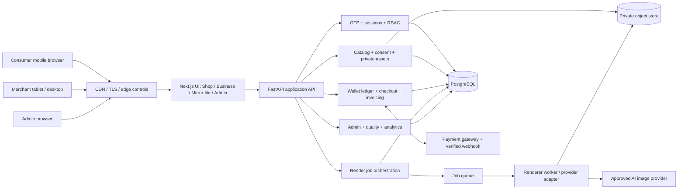

# wearo.ai — MVP implementation specification

**Spec-driven development (SDD) | Frontend + Backend | Version 1.0 — 17 October 2026**  
**Status:** Proposed engineering baseline; not an implementation or a claim that any integration is already deployed.  
**Source of scope:** *Wearo AI MVP Product and Platform Requirements v1.0* (16 Oct 2026), itself an overlay of Master v3.0.  
**Source of visual rules:** *Wearo AI Brand Colours and UI Guidelines v1.0* (Oct 2026).

> **Traceability contract.** The requirements authority remains the attached MVP PDF: **90 selected WR IDs** (59 P0 / 31 P1; 29 FULL / 61 BOUNDED). This document introduces **implementation labels** (FE, BE, API, QA, DEC), **not new product WR requirements**. The 107 deferred WR items remain deferred. Proposed architecture, timings, defaults, and schema design must be reviewed; they do not silently change the product master.

## 1. Executive implementation contract

### 1.1 What the team will build

A single responsive web platform with three authenticated experiences and one optional guest storefront:

| Experience | Primary form factor | Identity and audience | Pilot outcome |
|---|---|---|---|
| **Wearo Shop** | Phone-friendly web | Guest entry; verified consumer email OTP before generation or saved content during the simple beta | Reusable person profile + uploaded wearable item -> consent -> allowance -> AI preview -> compare, zoom, feedback and repeat |
| **Wearo Business** | Desktop / tablet | Merchant owner email OTP | One boutique/jeweller tenant, up to 10–30 curated active pilot items, owner wallet, invoices, usage, one associate role |
| **Wearo Mirror-lite** | Tablet / desktop browser | Tenant associate email OTP; customer is a temporary, consented guest | Staff-guided garment or jewellery preview -> exact-item enquiry or finish and clear session |
| **Wearo Admin** | Desktop web | Separate administrator credentials + mandatory MFA | Tenant/entitlement, packs/pricing, approved model routing, audit/usage, dispute and operations |

**Shared platform:** One authentication policy layer, tenant/owner authorization, catalogue, private image workflow, render orchestration, prepaid **Wearo Token** ledger, payment confirmation, and auditable administration. Wearo Tokens are *published retail billing units*, not provider API input/output tokens.

### 1.2 Ship / do not ship boundary

**Ship:** guest exploration; phone OTP; email OTP; admin password+MFA; photo capture/upload with guidance and validation; affirmative consent; supported garment category configuration; one adult neutral mannequin; merchant photo/catalogue; static single-result rendering; original/product comparison and zoom; regeneration as separately disclosed billable action; basic feedback; necklaces/pendants and earrings behind fidelity gate; store sessions; opted-in enquiries; two token pack sizes; Indian gateway payment; business tax invoice; wallet histories/recredits; essential B2B metrics; admin model and tenant controls; deletion/support mechanisms.

**Do not ship:** native apps, 3D avatars, true fit measurement, AR/live video, stock sync, QR jewellery scanning, rings/bangles, custom blouse construction, tailor-ready Studio specs, inventory/branch hierarchy, AI wardrobe stylist, booking engine, subscription, provider fine-tuning UI, multi-country billing or public status portal.

**Category rollout is gated:** Wave 1 = approved clothing (initial Western shirts / T-shirts / tops and any individually approved kurta or curated saree slice). Wave 2 = approved necklace/pendant/earring products only if jewellery fidelity gate passes. The MVP PDF calls for selecting exactly 2–3 garment categories before launch; initial candidates are *not automatically approved*.

### 1.3 Normative and proposed language

- **SOURCE** = explicit function or boundary in either uploaded PDF; cited by original `WR-###`.
- **SPEC** = how engineering proposes to implement SOURCE, including interfaces and acceptance checks; changeable without renumbering WR.
- **DEC-XX** = unresolved product/operator decision that must be filled before production pilot. Values shown as examples are placeholders, **not commercial commitments**.
- **Must** in an implementation contract describes a proposed team-build condition. It does not upgrade a deferred source item into the MVP.

## 2. Engineering decisions and architecture baseline

### 2.1 Proposed stack (replaceable choices, not specified by the source PDFs)

| Concern | Proposed implementation | Why / replacement boundary |
|---|---|---|
| Responsive frontend | Next.js + React + TypeScript; shared accessible design-system package | Phone, tablet, desktop browser in one codebase; no native app |
| API and domain logic | Python FastAPI (typed Pydantic contracts); split into modules in one deployable modular monolith | Short MVP build cycle and useful Python AI-provider integration |
| Async processing | Managed job queue + separate Python worker | Renders and gateway callbacks must not block request threads |
| Transactional storage | PostgreSQL; row-level domain authorization enforced in code + tested tenant policies; optional DB RLS defense-in-depth | ACID wallet, idempotency and auditable ownership |
| Private objects | Object storage with server-generated private keys and short-lived signed access | Never expose permanent public customer-photo URLs |
| Cache / throttling | Redis or managed equivalent for OTP and burst controls | Rate limit, OTP lifecycle, short-lived session state |
| OTP providers | Replaceable Indian SMS provider and transactional email provider | No vendor selection is presumed |
| Payments | Replaceable Indian gateway adapter with signed webhooks and server verification | UPI/cards per enabled merchant account; no fabricated gateway claims |
| AI renderer | Provider adapter behind use-case routing, versioning, quality gates | Admin-approved model choice, no fine-tuning UI |
| Infra | One India-region deployment for pilot, TLS, managed secrets, encrypted storage and backups | India pilot simplification; confirm regulatory posture before launch |
| Instrumentation | Structured logs + trace IDs + product events + cost/usage aggregation | Traces for money, consent, quality and traction |

**Deployment separation:** `web` (public pages and SSR), `api` (privileged domain and identity), `worker` (expensive/private renders), `scheduler` (expiry/retention/reconciliation). These may share a source repository but **not** wallet or tenant authorization shortcuts.

### 2.2 Logical component diagram



### 2.3 Repository topology and responsibility boundaries

```text
wearo/
  apps/web/                 # Next.js: (shop), (business), (mirror), (admin)
  apps/api/                 # REST/OpenAPI endpoints, auth dependencies, validation
  apps/worker/              # provider adapters, asynchronous jobs, quality checks
  packages/ui/              # shared components and design token definitions
  packages/contracts/       # generated typed API client from openapi.yaml
  packages/config/          # non-secret shared offering/category vocabulary
  infrastructure/           # declarative infra, CI/CD, secret references
  specifications/           # THIS spec, openapi.yaml, traceability and test cases
  tests/                    # contract, security, e2e, quality golden set
```

**Service layer modules (BE-01…BE-11):** identity; tenant/roles; catalog; media+consent; rendering; wallet+pricing; payments+invoices; enquiries/store session; feedback/trust; admin+model; analytics+audit. No frontend or async worker may alter wallet balances directly.

## 3. Actors, security contexts and permissions

### 3.1 Principal types

| Principal | Context | Allowed | Never allowed |
|---|---|---|---|
| Guest | Anonymous browser, no private account | Discover enabled items, mannequin preview of *catalog samples* if policy allows, inspect limitations | Access wallet, purchased tokens, persistent personal results or paid render |
| Consumer | `principal_type=consumer` + verified phone | Own photo/results, pay/recredit, own wallet, delete/report, own enquiries | Read tenant inventory administration or others' photos |
| Merchant owner | `principal_type=business` + tenant + verified email | Manage own catalog and staff, top up tenant wallet, view invoices/usage, staff sessions as permitted | Select arbitrary paying tenant, access other tenants or admin APIs |
| Merchant associate | Tenant membership + verified email | View published tenant catalog, create/end guest sessions, render with tenant wallet, create consented enquiries | Change token packs/merchant billing, invite users, export other guest photos |
| Platform admin | Dedicated admin identity + MFA + scoped permissions | Manage tenant status, pricing/model configuration, reviewed cases and aggregate operations | Default access to consumer raw photos; ordinary store roles or wallet use |
| Async worker | Service identity + per-job scoped access | Read permitted job assets; write result; report status/cost | Read arbitrary tenants or publish assets without finalization |

### 3.2 Authorization invariant

Every resource request resolves an authenticated actor, **effective paying account**, and `tenant_id` or `consumer_id` on the server. Client-supplied `tenant_id`, `wallet_id` or `owner_id` is **never sufficient** authorization. Foreign IDs return a generic `404` or `403` without confirming private object existence. No cross-tenant query, download, signed URL, feedback, payment callback or object key access is acceptable (`WR-126`, `WR-152`, `WR-153`).

Use short-lived HTTP-only secure browser sessions and CSRF protection on cookie-auth mutations. OTP: hashed one-time challenges, max attempts, expiry, resend cap, destination rate limits and generic responses to prevent account enumeration. Admin: independent realm and MFA, no bypass via merchant auth.

### 3.3 Business wallet spending delegation

An associate spends the tenant wallet **only** on authorized in-store render actions. Ownership, pack pricing, invoices, staff invitations and model controls are owner/admin privileges. Each render records both `performed_by_principal_id` and `charged_account_id`.

## 4. User journeys as executable contracts

### FE-01 / Consumer photo try-on (`WR-001…WR-043`, selected only)

**Approved upload-first simplification (PD-01 / DEC-01 / DEC-02, effective 2026-10-17):** the primary consumer path does not require a pre-listed catalogue item or a user-selected category. A signed-in user creates a reusable, consented person profile and then supplies a wearable-item image, including apparel or jewellery. Existing merchant catalogue flows remain separate. The service classifies and routes the supplied item internally, asks for clarification when multiple or ambiguous items are detected, and rejects unsupported input before quota use. During the beta, detected jewellery returns “not yet supported” until a separate jewellery-capable provider passes the fidelity gate; materially altered designs must never be delivered. Profile photo, face and optional height/weight information guide visual identity and approximate proportions only; they are not measurements and must never produce sizing or fit claims. The profile remains reusable until user deletion or expiry under the approved DEC-04 policy.

**Approved free-beta economics (PD-02 / DEC-03, effective 2026-10-17):** each verified user may receive three successful generations per calendar day. Rejected preflight inputs and failed generations do not consume the allowance. Show remaining daily allowance before confirmation. Token balances, paid packs and payment checkout remain outside the simple beta flow while their existing implementation/backlog is preserved for later commercial approval.

**Approved beta identity and payment scope (PD-03 / DEC-05, effective 2026-10-17):** consumers authenticate with verified email OTP. Phone/SMS OTP, payment checkout, GST handling and tax invoices are inactive in the simple beta; their existing requirements and implementation remain preserved for a separately approved commercial release. Email OTP must be hashed, short-lived, single-use, rate-limited and enumeration-resistant.

1. Landing/Discover (guest): present the upload-first try-on entry point; merchant catalogue discovery, when enabled separately, retains retailer-versus-concept attribution.
2. Person profile: after authentication, capture/upload the user's photo with framing, lighting and one-person guidance; optionally accept height and weight as generation guidance. Obtain affirmative consent, save the private profile for reuse, and provide a prominent delete-profile control. Do not charge invalid input.
3. Consent: check affirmative permission to transform photo, adult/age policy and retention/training notice. Record `consent_version`, timestamp, actor and intended purpose; no default training use.
4. Product input and allowance: accept a wearable-item image without requiring a pre-listed item or category selection; detect and route its type internally, request clarification for an ambiguous or multi-item image, then show the remaining free-beta daily allowance, limitations and regeneration rule. Do not invent product identity or seller details. Require a verified user before generation.
5. Preflight: upload securely, validate person profile and item image, consent, entitlement and detected capability; issue a price-locked quote/confirmation; fail before reservation for unsupported, ambiguous or invalid input.
6. Render: reserve one daily allowance slot atomically and enqueue; show pending/processing; poll status; no duplicate request on refresh. On success deliver a labelled AI preview and consume one successful-generation allowance. On rejection or failure release the slot without consuming allowance, explain correction and permit retry.
7. Result: show source photo **and** original item alongside generated result, zoom, approximate/non-fit warning, thumbs-up/down reasons, report/remove/delete, and optional repeat with newly disclosed charge.
8. Traction: capture delivered-preview, repeated-preview, first real-money pack purchase and usable feedback with no unnecessary personal content in event payloads.

**Definition of done:** Real consumer can complete this on a phone browser; the same render request cannot charge twice, and another consumer cannot open its original or result.

### FE-02 / Merchant owner onboarding and administration (`WR-144…WR-153`, etc.)

1. Choose **boutique** or **gold jeweller**; verify business email via OTP.
2. Create one `business` tenant; capture legal/trade name, contact, invoicing address, state and optional GSTIN if applicable; show summary at purchase.
3. Add 10–30 curated catalog items with original image, exact item code, category, variant/known attributes, and optional exact seller product URL; owners can unpublish items.
4. Invite or revoke **associate** by verified email. Owner buys standard/discounted pack; signed gateway webhook credits only own wallet once; download valid invoice after confirmation.
5. View wallet transactions, render volume, basic item interest and opted-in enquiry counts, with no branch-level analytics.

**Definition of done:** New merchant can self-onboard, upload an existing product, fund wallet, invite an associate and view a traceable usage/invoice record.

### FE-03 / Staff-assisted Mirror-lite (`WR-075…WR-096`, selected only)

1. Associate opens `/mirror`, sees tenant brand/categorized collection, starts fresh session on tablet or desktop.
2. Customer consents on screen, with explicit adult/permission and retention notice. Capture/uploads own portrait (not an identity account); allow neutral mannequin if policy permits.
3. Choose only approved inventory item: boutique existing garment or necklace/pendant/earring. If jewellery category disabled, it must not be selectable.
4. See source item, cost and current tenant balance; authorized associate confirms. Show render progress, original photo, AI result, full seller item identifiers, approximate size warning, compare and zoom.
5. For enquiry, **customer affirmatively chooses** to share contact and exact selected item. Associate submits; UI names receiving merchant and follow-up channel. No appointment scheduling or real-time stock assurance.
6. Press **Finish / Clear for next customer**; immediately revoke temporary access, remove session URLs/state from browser, and enqueue object cleanup per retention policy. Idle timeout must do the same without staff action.

**Definition of done:** The next shopper cannot recover the previous shopper's photo/result through back navigation, reload, cached storage or old signed links. Backend scope/TTL always enforces revocation.

### FE-04 / Admin operational loop (`WR-175…WR-193`, selected only)

1. Admin signs in separately (username/password + MFA); role-specific dashboard includes user/tenant counts, submitted/succeeded/failed renders, purchased/spent tokens, revenue, model cost and B2C/B2B filters.
2. Admin activates/suspends tenant/offering with logged reason, manages pack prices/discount effective dates and approved renderer versions by use case.
3. Disabling a model or category immediately blocks **new** jobs/quotes; in-flight jobs finish or are cancelled/recredited under published policy.
4. Review job failures, anonymous feedback aggregates, unusual spend/OTP rate alerts, customer requests and payment discrepancy statuses; log any manual correction to the append-only financial record.

## 5. Frontend specification: application information architecture

### 5.1 Routes, views and guard conditions

| FE view / route | Form | Required guard / important behavior | Source IDs |
|---|---|---|---|
| `FE-S01 /` and `/shop` | Phone-first, guest allowed | Visible category gate, retailer-vs-concept labels, premium plum CTA | WR-001,002,011,021,043 |
| `FE-S02 /shop/item/:itemId` | Phone | Original product image, category/variant and exact seller link only when verified | WR-013,017,020,110 |
| `FE-S03 /shop/photo` | Phone | Camera/gallery, adult neutral mannequin, framing; validate before paid confirmation | WR-003,004,007,125 |
| `FE-S04 /shop/consent` | Phone | Mandatory affirmative checkbox/action, permission and storage/training notice | WR-006,124,130 |
| `FE-S05 /auth/phone` | Phone | OTP expiry/resend/retry; only before paid or persistent content | WR-140,141,142 |
| `FE-S06 /shop/confirm` | Phone | Action, item, exact tokens, wallet balance, limitations, new-charge consent | WR-027,129,158,159 |
| `FE-S07 /shop/jobs/:id` | Phone | Poll progress, recover/retry, accessible live status; never auto-buy twice | WR-040,128,191 |
| `FE-S08 /shop/results/:id` | Phone | AI label, comparison, zoom, feedback/report, delete and new price for re-render | WR-010,025–030,039,120–122,127 |
| `FE-S09 /wallet` | Phone | Balance, promo label/expiry, top-up, debits and recredits | WR-157–167 |
| `FE-S10 /wallet/top-up` | Phone | Standard and bulk discount pack, checkout and receipt; authenticated | WR-162,163,170,171 |
| `FE-S11 /business/register` | Desktop/tablet | Business type, required invoice data, email OTP and creation | WR-144–149 |
| `FE-S12 /business` | Desktop/tablet | Tenant KPIs, wallet balance, usage/enquiries | WR-134,096,129 |
| `FE-S13 /business/catalog` | Desktop/tablet | Owner add/update/unpublish 10–30 validated records | WR-017,020,075,083 |
| `FE-S14 /business/staff` | Desktop | Owner-only invite/revoke associate | WR-150 |
| `FE-S15 /business/credits` | Desktop/tablet | Owner top-up, history and business invoice downloads | WR-157–173 |
| `FE-S16 /business/enquiries` | Desktop/tablet | Consented item-linked enquiry summary; no direct guest photo by default | WR-084,092,113,119 |
| `FE-S17 /mirror` | Tablet-first | Tenant associate, catalog, fresh session, prominent reset | WR-086,089,093 |
| `FE-S18 /mirror/session/:id` | Tablet-first | Linear capture, consent, item, render, compare, enquiry, finish | WR-075–096 |
| `FE-S19 /admin/login` | Desktop | Separate login + mandatory MFA | WR-175 |
| `FE-S20 /admin` | Desktop | B2C/B2B period metrics and cost | WR-176 |
| `FE-S21 /admin/tenants` | Desktop | Entitlement status, reasoned activate/suspend, audit | WR-177,189 |
| `FE-S22 /admin/packs` | Desktop | Effective-dated published pack / pricing controls | WR-178 |
| `FE-S23 /admin/models` | Desktop | Approved renderer versions, capability & category on/off | WR-181,182 |
| `FE-S24 /admin/operations` | Desktop | Render/payment problems, support/data requests, protected audit | WR-188,189,192,193 |

Route names are **proposed implementation paths**, not source-prescribed URLs. No link may expose unentitled or unsupported features merely because the route exists.

### 5.2 Design system: exact source colours

| Design token | Hex | Required use |
|---|---|---|
| `brand.plum` | `#3B1746` | Primary action, main navigation, brand emphasis |
| `brand.aubergine` | `#251129` | Premium dark surfaces |
| `brand.gold` | `#C9A46B` | Sparse premium highlights, jewellery accents, star motifs |
| `canvas.ivory` | `#FAF7F2` | Light Shop and Business primary canvas |
| `surface.white` | `#FFFFFF` | Cards, text inputs |
| `state.lilac` | `#F1EAF1` | Selected cards/options; *always* also icon/text state |
| `ink.charcoal` | `#261C2A` | Main heading and reading text |
| `ink.mauve` | `#716775` | Secondary text |
| `border.mauve` | `#E8DFE7` | Thin separators and input borders |
| `dark.midnight` | `#190E1C` | Mirror-lite base canvas |
| `dark.surface` | `#2D1C32` | Mirror-lite panel surface |
| `ink.deepGold` | `#866037` | Readable small gold-toned copy on pale surfaces |

**Source colour balance for B2C** (guideline rather than screen-by-screen enforcement): 60% ivory, 25% plum, 10% gold, 5% lilac; product/photo imagery remains dominant. **Screen profile:** Shop + Business/Admin = light/neutral; Mirror-lite = cinematic dark/plum with contrasting source/preview. Do **not** use low-contrast champagne gold as small text on ivory. On plum primary buttons use white text. Use gold on dark plum for high-value accents, not every action.

**Proposed (not source-prescribed) spacing/shape breakpoints:** 4/8/12/16/24/32 px spacing steps; rounded cards 12–16 px; 44 px minimum tap target; phone up to 767 px; tablet 768–1199 px; desktop >= 1200 px. Use a consistent readable system sans font pending typography sign-off. Check WCAG 2.2 AA contrast, keyboard sequence and screen reader labeling on all money/consent steps.

### 5.3 Component contracts

| Component | Props / emitted events | Required states |
|---|---|---|
| `CategoryGrid` | enabled categories, onSelect | loading, visible, disabled-with-reason, empty |
| `ProductSourceCard` | id, type, image, seller, code, variant, item URL | original vs concept, no fabricated stock badge |
| `PersonImageUploader` | temporary upload intent, file, onValidated | camera/gallery, size/type error, pose error, processing |
| `ConsentCapture` | consent version, purpose, store-session flag | unchecked, accepted, validation error; never prechecked |
| `TokenQuoteCard` | action, quoteId, price, balance, expiration, onApprove | enough, insufficient/top-up, expired/reprice, unavailable |
| `RenderProgress` | renderId/status, polling/backoff | queued, processing, quality-check, delivered, failed |
| `PreviewComparison` | original person, item source, result, label, limitation | side-by-side, mobile slider/toggle, zoom, missing/private asset |
| `ResultFeedback` | resultId, positive/reason, report/delete | unsent, sent, moderation, delete confirmation |
| `BusinessCatalogEditor` | item meta, image intent, active flag | draft, quality pending, approved, disabled, unpublished |
| `MerchantSessionShell` | sessionId, timeout, finish, consent | fresh, active, cleared, timed-out; blocks stale back |
| `WalletSummary` | purchased, promo, reserved, spendable, history | refresh, pending provider, credited, reversal, discrepancy |
| `AdminModelSelector` | category, approved versions, status | active, disabled, changed with audited reason |

### 5.4 Screen-level UI acceptance and privacy

**Consumer:** At width 360 px, the complete consent, price and primary action are reachable without sideways scrolling. Try-on CTA prominent in plum; photo/source image each gets a meaningful accessible label; high-contrast error text plus icon; mobile camera permission denied falls back to gallery.

**Mirror-lite:** At tablet landscape width, preview uses largest available area. Collapsible collection side rail, large image stage, bottom compare/enquiry/finish controls. The **Finish / Clear** control remains visible, with confirmation and automatic idle expiry. Avoid browser persistence of guest raw photos (no localStorage, indexedDB, durable cache, analytics image payloads). `Cache-Control: no-store` for session/private responses.

**Business/Admin:** Neutral compact tables, clear filters and obvious financial difference between **available**, **reserved** and **used** tokens. Counts shown in the brand PDF's example dashboard are **illustrative**, not seed data or expected business metrics.

**Accessibility:** Keyboardable dialogs, focus return, explicit error announcements, logical heading order, zoom to 200%, inputs with labels rather than placeholders only, visible token price in text (not color) and empty/error/recovery screens.

### 5.5 Frontend async and error policy

- Only render calls explicitly triggered by `Approve` may carry idempotency keys; if network disconnects, use the same key and check existing job instead of submitting again.
- When user navigates away, a processing job remains associated with its paying account; UI can resume via `GET /renders/{id}`. User logout removes local sensitive references.
- Failed input check: show guidance and no debit. Provider/model failure after reservation: show `tokens restored / not charged` **only after authoritative wallet result**, never preemptively.
- Payment redirect return is **not** payment proof; show “Verifying payment” until backend webhook+verification completes.
- Transient API retries: exponential backoff on GET; no auto-retry of non-idempotent POST unless `Idempotency-Key` reused.
- Anonymous events exclude image bytes, exact phone/email, OTP, face data and unrestricted image links.

## 6. Backend: domain model and storage contracts

### 6.1 Tenancy pattern

**Paying account abstraction:** `account {id, kind=CONSUMER|TENANT, owner_reference, status}`. Each has exactly one `wallet`. Consumers have personal `account_id`; businesses have tenant `account_id`; admin operations are not billable preview accounts. Every tenant-owned row carries `tenant_id` plus `account_id` if billable. Database policies and repository queries always scope by authorized account.

### 6.2 Core entity dictionary

| Entity (table) | Fields that must exist | Constraint / retention |
|---|---|---|
| `principals` | id, type, phone/email verified flag, status, created_at | unique normalized identity; no plain OTP data |
| `auth_challenges` | id, destination_hash, channel, code_hash, expires_at, attempts, resend_count, consumed_at | one-time, bounded life, hashed secret |
| `sessions` | id, principal_id, auth_realm, expires_at, revoked_at | server-invalidatable; separate admin realm |
| `business_tenants` | id, legal/trade name, business_type, state, invoice address, nullable GSTIN, status | unique slug, one pilot location only |
| `tenant_members` | tenant_id, principal_id, role=`OWNER|ASSOCIATE`, revoked_at | unique active membership, audited changes |
| `accounts` | id, kind, consumer_id XOR tenant_id, status | exactly one owner context per billable action |
| `offerings_entitlements` | account/tenant/category, enabled, effective times | only enabled categories shown/charged |
| `catalog_items` | id, tenant_id (nullable for central), code, type, title, original_image_key, attributes_json, merchant_url, status | per-tenant item code unique, no invented inventory |
| `category_quality_gates` | category, use_case, approval_status, review_version, enabled_at | no unapproved new jobs; jewellery initially disabled |
| `person_assets` | id, owner_account_id or guest_session_id, object_key, content_hash, mime, validation_state, delete_after | private, signed read, retention policy |
| `consents` | id, subject/session ref, actor, consent_version, purpose, permission_asserted, accepted_at | affirmative, immutable evidence without needlessly storing photo |
| `guest_store_sessions` | id, tenant_id, associate_id, state, expires_at, finished_at | temporary, cannot resume after finish |
| `render_jobs` | id, owner_account_id, tenant_id nullable, session_id nullable, item_id/source_asset_id, person_asset_id, quote_id, provider_model_version, status, cost_tokens, idempotency_key, error_code, created_at | per-account unique idempotency key; full status audit |
| `render_results` | job_id, private_object_key, generated_at, disclosure_version, validation_result | accessible only to authorized owner/active guest session |
| `feedback_reports` | id, job_id, kind, reason, actor, removal_status, created_at | moderation workflow, no unconsented sharing |
| `wallets` | id, account_id, currency_units=`WEARO_TOKEN`, version | unique owner account |
| `wallet_ledger` | id, wallet_id, type, amount_signed, related_payment/job, created_at, idempotency_ref | append-only; no arbitrary overwrite |
| `wallet_reservations` | id, wallet_id, render_job_id, amount, promo_allocation, status, expires_at | one active reservation/job, atomic settlement |
| `wallet_credit_lots` | id, wallet_id, purchased_or_promo, quantity, remaining, expiry | separate promo from purchased, deterministic spend priority |
| `token_price_versions` | id, action, category, price_tokens, effective_from/to, active | price quoted/locked by version |
| `token_packs` | id, audience, token_quantity, base_price_inr, discount_inr, final_price_inr, effective_from/to, status | B2C/B2B identical *policy*, published pack availability |
| `payment_orders` | id, owner_account_id, provider_order_id, pack_id, amount, currency, state, idempotency_key | unique provider order/event refs |
| `payment_events` | provider_event_id, type, verified_at, raw_hash, handled_at | unique webhook id; no duplicate credit |
| `invoices` | id, payment_id, sequential_invoice_number, invoice_snapshot_json, tax_snapshot_json, pdf_object_key | immutable after issue; legally reviewed template |
| `enquiries` | id, tenant_id, session_id, catalog_item_id, contact_channel, contact_encrypted, contact_consent_at, state | exact item and opt-in; no appointment engine |
| `privacy_requests` | id, actor/account_ref, type, submitted_at, state, resolved_at | manual traceable handling |
| `support_cases` | id, actor, job/payment ref, reason, state, resolution | audit adjustment references |
| `model_registry` | id, provider, version, use_case, capability, approved, enabled, allowed_segments | active allowed version only |
| `model_routes` | use_case, category, version_id, effective_from, changed_by | version captured per job |
| `audit_events` | id, actor, action, entity, entity_id, timestamp, request_id, reason, metadata_redacted | access-controlled, append-only |
| `analytics_events` | id, occurred_at, actor_segment, event_name, anonymous_dimensions | no images/contact PII |

**Storage safety:** Blob keys must be opaque. Never log access tokens, OTP codes, image URLs, contact details or generated facial content. Database backups inherit restricted access/retention and restore procedures. Implement a scheduled deletion job, verifiable deletion statuses and revoked signing capability. Historical tax invoices and minimum lawful financial records must be retained according to counsel-approved rules; do not delete financial evidence merely because an image is deleted.

### 6.3 Suggested indexes and transaction boundaries

- Unique `render_jobs(owner_account_id,idempotency_key)`, `payment_events(provider_event_id)`, `payment_orders(provider_order_id)`, `wallets(account_id)`, active tenant membership and invoices by invoice number.
- Scope indexes `catalog_items(tenant_id,status,category)`, `render_jobs(owner_account_id,created_at DESC)`, `enquiries(tenant_id,created_at DESC)` and ledger by wallet/time.
- Wallet reserve/settle/release must lock wallet balance or use serializable transaction / atomic conditional write. A positive ledger row can never be created without a signed legitimate payment, authorized promo grant or auditable reversal.
- Database writes (status change + debit ledger + reservation finalization) commit atomically. Notifications/event delivery use **transactional outbox** or equally safe replayable mechanism.

## 7. Backend: APIs and contracts

### 7.1 API conventions

- Root: `/api/v1`; HTTPS only; JSON in/out except `POST /assets/upload-intents` and signed object-store transfer. `Idempotency-Key` required on token spend, payment-order creation, and write actions vulnerable to replay.
- Authentication: secure HTTP-only browser cookie with CSRF on state changes (OpenAPI defines cookie-based sessions and an anti-CSRF header on protected mutations; provider webhooks use signature verification).
- Every write returns `request_id`; background actions respond `202` with resource ID/status URL; standard errors use `{code,message,request_id,details?}`. Never expose private existence or internal provider prompt/logs.
- Pagination: `limit`, opaque `cursor`; timestamps UTC ISO 8601; amounts in integer INR minor units (`paise`) and integer Wearo Tokens; never floating point money.
- `403`: authenticated but not authorized; `404`: unknown or tenant-hidden; `409`: version/idempotency conflict; `422`: validation/unsupported category; `429`: throttled; `503`: provider unavailable.

### 7.2 Endpoint inventory (proposed contract surface)

| API group | Endpoint | Permission | BE acceptance |
|---|---|---|---|
| Identity | `POST /auth/phone-otp/request`, `/verify` | Public OTP throttle | Valid verify -> consumer session; resend/expiry/attempt policy |
| Identity | `POST /auth/email-otp/request`, `/verify` | Public OTP throttle | Owner/associate context from verified email; no rogue tenant context |
| Admin identity | `POST /admin/auth/login`, `/admin/auth/mfa/verify` | Admin realm | Password alone never creates active admin session |
| Session | `GET /me`, `POST /auth/logout` | Session | Identity and entitled account metadata; revoke |
| Public catalog | `GET /categories`, `GET /catalog/items`, `GET /catalog/items/{id}` | Guest/entitled filter | Quality gate + unpublish filter + source image trace |
| Asset validation | `POST /assets/upload-intents`, `POST /assets/{id}/validate` | Owner or scoped guest session | Private upload, type/size, pose/content validation |
| Consent | `POST /consents` | Consumer/temporary guest | Versioned affirmative record before processing |
| Pricing | `POST /quotes`, `GET /quotes/{id}` | Verified account or scoped store session | Correct price-version, wallet and expiry; no charge |
| Rendering | `POST /renders`, `GET /renders/{id}`, `GET /renders` | Account owner / authorized staff | Idempotent reserve/queue/settle, private access and errors |
| Result | `GET /renders/{id}/assets`, `DELETE /renders/{id}` | Owner or active store session | Short-lived signed original/result URLs and deletion |
| Feedback | `POST /renders/{id}/feedback`, `/report` | Owner or active store session | Reason-coded feedback and complaint/remove |
| Wallet | `GET /wallet`, `GET /wallet/transactions` | Paying context | Consistent purchased/promo/reserved/available balance |
| Packs | `GET /token-packs` | Consumer/owner | Both audience packs, published discount, effective dates |
| Payments | `POST /payment-orders`, `GET /payment-orders/{id}` | Consumer/owner | Create gateway order only; confirm credits on verified server event |
| Gateway | `POST /webhooks/payments` | Gateway signature | Replay-safe credit once, ledger/invoice reconciliation |
| Invoice | `GET /business/invoices`, `GET /business/invoices/{id}` | Owner scoped to tenant | Correct business invoice and controlled download |
| Business | `POST /business/tenants`, `GET/PATCH /business/tenant` | Verified owner | Minimal Indian invoice fields, optional GSTIN |
| Staff | `POST /business/staff/invitations`, `DELETE /business/staff/{memberId}` | Owner | Invite/revoke with role and audit |
| Catalog edit | `POST /business/catalog/items`, `PATCH .../{id}`, `DELETE .../{id}` | Owner | Real SKU, images, publish/unpublish; no stock sync |
| Sessions | `POST /business/store-sessions`, `GET .../{id}`, `POST .../{id}/finish` | Associate/owner | Private temporary session, expiry, cleanup |
| Enquiries | `POST /business/store-sessions/{id}/enquiries`, `GET /business/enquiries` | Associate/write; owner/read | Explicit contact opt-in + exact catalog item |
| Metrics | `GET /business/overview` | Owner | Sessions, renders, selected items, opted-in enquiry counts |
| Privacy | `POST /privacy-requests`, `GET /privacy-requests/{id}` | Owner/consumer | Traceable manual state |
| Support | `POST /support/cases`, `GET /support/cases/{id}` | Owner/consumer | Issue ref/status, manual review |
| Admin ops | `GET /admin/overview`, `GET /admin/tenants`, `PATCH /admin/tenants/{id}` | Admin MFA | Segment filters, reason, entitlements/audit |
| Admin pricing | `GET/POST /admin/token-packs`, `PATCH /admin/token-packs/{id}` | Pricing admin | Effective-dated pack change, no retroactive repricing |
| Admin AI | `GET /admin/models`, `PATCH /admin/model-routes/{useCase}` | AI admin | Approved version only; audit and category disable |
| Admin cases | `GET/PATCH /admin/cases/{id}`, `GET /admin/audit` | Scoped admin | Resolution/audit and no raw customer photos by default |

`openapi.yaml` in the accompanying SDD package supplies illustrative wire schemas and examples; this inventory controls scope if draft schema shortcuts exist.

### 7.3 Key request/response examples

**Request: quote a single approved render (no debit)**

```json
POST /api/v1/quotes
{
  "use_case": "GARMENT_TRYON",
  "catalog_item_id": "itm_123",
  "person_asset_id": "ast_456",
  "consent_id": "con_789",
  "store_session_id": null
}
```

```json
200 OK
{
  "quote_id": "quo_001",
  "action": "GARMENT_TRYON",
  "cost_wearo_tokens": 5,
  "available_wearo_tokens": 20,
  "price_version": "price_2026_01",
  "expires_at": "2026-10-17T08:15:00Z",
  "disclaimer": "AI visual preview only; fit, size and drape not guaranteed."
}
```

**The values 5 / 20 and expiry above are API examples only; DEC-03/04 must approve actual values.**

**Request: commit user-approved render**

```json
POST /api/v1/renders
Idempotency-Key: <stable-client-generated-uuid>
{
  "quote_id": "quo_001",
  "approved_cost_wearo_tokens": 5
}
```

```json
202 Accepted
{
  "render_id": "rnd_002",
  "status": "QUEUED",
  "status_url": "/api/v1/renders/rnd_002"
}
```

**Job status** returns `QUEUED|PROCESSING|QUALITY_CHECK|SUCCEEDED|FAILED|CANCELLED`; on success it includes result metadata and `charge_status=SETTLED`. On failure `charge_status=RELEASED|RECREDITED` and a safe recovery message; do not expose a “not charged” claim while funds reconciliation is incomplete.

**Error envelope**

```json
{
  "code": "UNSUPPORTED_CATEGORY",
  "message": "This item cannot be previewed yet. Choose an enabled category.",
  "request_id": "req_abc",
  "details": {"category": "BANGLE"}
}
```

### 7.4 API contract test rules

For each mutating path, generate valid, unauthenticated, wrong-tenant, missing-consent, expired-OTP/quote, duplicated-idempotency, rate-limit, invalid input and 5xx provider fault tests where meaningful. Maintain typed clients generated from checked-in `openapi.yaml`, and fail CI on contract drift. No endpoint accepts raw uncontrolled object-store path or provider URL from clients.

## 8. Backend workflows and state transitions

### BE-01 / OTP and account lifecycle

`OTP_REQUESTED -> SENT -> VERIFIED | EXPIRED | BLOCKED`; OTP consumed on success, single-use, generation-specific and rate limited per identity/device/IP. Merchant account creation only after verified email. Revoked staff membership invalidates authorization even if a browser session remains valid. Admin realm has separate password/MFA and brute force protections. Password reset and recovery must follow established controls before public launch; not a consumer sign-in feature.

### BE-02 / Image validation and consent pipeline

1. `upload-intents` returns short-lived scoped write; uploads land private and quarantined.
2. Check MIME by **bytes**, size/pixels, malware and safe supported content. Check single person / pose / crop / lighting where applicable. Image processing must operate inside a permitted region/provider under disclosed policy.
3. Reject unusable assets **before quote/reservation** with actionable error codes: `POOR_LIGHT`, `MULTIPLE_PEOPLE`, `CROPPED_SUBJECT`, `UNSUPPORTED_FILE`, `UNSUPPORTED_CATEGORY`.
4. Check consent `accepted=true`, correct version, actor authorization, permitted use, date and still-active merchant session.
5. Personal images are never silently used to train a model. Source-proposed policy is **no default training and no training opt-in UI in MVP**. Provider data retention/training terms require contract review.
6. Delete/expire photos and derived thumbnails with an auditable async cleanup record; stale assets fail read even while bytes await purge.

**Age control:** initial pilot may be **adults-only** if approved by DEC-06; UI and backend must block unsupported minor image submissions. No claim that a guardian consent solution already exists.

### BE-03 / Render job machine and compensation

```mermaid
stateDiagram-v2
  [*] --> PREFLIGHT
  PREFLIGHT --> REJECTED: invalid photo/category/consent
  PREFLIGHT --> RESERVED: price current, wallet sufficient, approval
  RESERVED --> QUEUED: persist job + queue outbox
  QUEUED --> PROCESSING: worker claims lease
  PROCESSING --> QUALITY_CHECK: provider produced asset
  QUALITY_CHECK --> SUCCEEDED: approved; atomic debit + release reservation
  QUEUED --> FAILED: exhausted retries
  PROCESSING --> FAILED: provider error / timeout
  QUALITY_CHECK --> FAILED: material fidelity violation
  RESERVED --> CANCELLED: cancelled before processing
  FAILED --> [*]: release reservation / recredit if needed
  CANCELLED --> [*]: release reservation
  SUCCEEDED --> [*]: result labelled + private access
  REJECTED --> [*]: no reserve / no charge
```



**Algorithm:** ensure unique `(paying_account,idempotency_key)` before any reserve; verify quote item/asset/account and expiry, category enabled, approved model route, consent and sufficient balance. Create job+reservation in one transaction, enqueue via outbox, return canonical job. Worker revalidates effective permissions/disable policy, uses recorded model version and tracks provider invocation. Persist result privately; quality check must pass; atomically insert one debit ledger entry, settle reservation, and mark `SUCCEEDED`; expose result after commit. Failure or unacceptable output releases held tokens. A retry with same key returns same job; a deliberate regeneration uses a **new quote + new key**.

**Pilot quality gate:** curated golden set per enabled garment/jewellery category; reviewers explicitly check face/skin/hair/apparent proportions, original product color/print/cut, and stone/design details. Reject material distortion. Do not claim calibrated sizing, gold purity/weight, real drape, inventory or guaranteed match. Automated heuristics can assist but must not replace early human review.

### BE-04 / Money, packs and ledger invariants

- `Wearo Tokens` integer pricing per successfully delivered action; provider LLM/image inference token count is an internal **cost** metric only.
- Wallet book = append-only `CREDIT_PURCHASED`, `CREDIT_PROMO`, `DEBIT_RENDER`, `REVERSAL`, `ADJUSTMENT` entries; holds tracked separately as reservations, not as irreversible spend.
- Available = unexpired purchased/promo available credits **less active holds**. Consumption order (promo vs purchased) and expiry rules must be published in DEC-03; report remaining promo separately (`WR-167`).
- Each successful paid render creates **exactly one** charge; failing or non-delivered requests leave **zero net debit** (`WR-128`, `WR-160/161`). No wallet goes negative; transaction counts remain consistent under concurrent associates.
- Gateway redirects are UI-only. Payment confirmation is a verified signed server callback and/or server-side provider status query. Provider `payment_id/event_id` unique; duplicate webhook yields no second tokens.
- Standard pack and **larger discounted pack** presented to B2C and B2B; show number of tokens, undiscounted price, savings, payable amount, GST/tax handling where applicable, effective prices and invoice fields. Keep immutable purchase snapshot.
- Invoice issued to correct confirmed paying legal person / business with appropriate numbering, date and tax details after local tax review; do not invent tax rates/exemptions. Refunds reconciled to original payment and ledger via auditable process.
- Reconciliation job detects `gateway confirmed / wallet missing`, `wallet credit without paid confirmation`, `invoice mismatch` and unsettled reservations. Escalate and block misleading financial displays until resolved.

### BE-05 / Merchant catalogue / jewellery quality

Owner may add/update/unpublish a limited set of genuine SKU records with original image, item code/name, type, known specifications, optional original seller link and status. The merchant must attest rights to use those source images; variants must be real catalog items. Only enabled category + approved image fidelity + published item can be rendered. Necklace and earring placement is **approximate**. Do not infer gold weight, dimension, stone grade, guaranteed fit or live stock. If seller URL not verified, show an enquiry rather than purchase link.

### BE-06 / Guest store session and enquiry

`CREATED -> ACTIVE -> FINISHED|EXPIRED`. Session stores tenant, associate, time, consent and a restricted person asset pointer. Association of item and render to session is immutable. On finish/expiry: revoke authorization and all server-issued photo/result links; tell UI to clear state and disable browser back reuse; queue deletion by approved retention policy. An enquiry **must** contain `catalog_item_id`, destination tenant, explicit contact-sharing consent and minimal encrypted callback information; no sharing to another retailer. Acknowledgment states the exact item, merchant and follow-up (no promised appointment slot).

### BE-07 / Administration and controls

Sensitive mutations require role check, MFA and `reason`, captured with actor/action/target/time/before-after summary. `model_registry` cannot route disabled/unapproved versions; effective-date rules prevent silently repricing already-issued quotes or purchases. Admin console initially aggregates usage and anonymous quality outcomes; access to images is not required for general admin reporting. Support/privacy cases track submitted/open/in-progress/resolved; manual wallet corrections include case, approver and compensating ledger event.

### BE-08 / Privacy and security guardrails

Data minimization by default. Signed GET/PUT URLs short-lived and scoped; store plain contact only encrypted. Encrypt transit and storage; secrets in managed store; CSP, CSRF, XSS and upload security; provider prompt injection controls on item captions and upload metadata. Security test tenant isolation with altered route/query/path IDs, support impersonation attempts, reused OTP, stolen signed links and session replay. Do not persist guest assets in browser caches or analytics. Log only stable pseudonymous IDs; no image bytes/OTP. Implement consent withdrawal/deletion with explicit handling of ongoing jobs and money settlement. Publish privacy/support policy with reviewed retention values.

## 9. AI model contract and quality evaluation

### 9.1 Rendering provider adapter

```python
class ImageTryOnAdapter(Protocol):
    async def render(self, *, person_private_ref: str,
                     product_private_ref: str, category: str,
                     consent_scope: str, model_version: str,
                     request_id: str) -> RenderProviderResult: ...
```

The adapter operates on private server-side references and returns a **private** asset + metadata (elapsed time, provider charge, version, moderation/quality status). It never sees a wallet ID as authority, and cannot mutate token balances. Prompts are versioned centrally, include product-identity instructions and never permit unsafe face swaps/identity distortion. Different approved renderers can be routed by garment vs jewellery if validation supports it; the platform is not tied to one model.

### 9.2 Golden dataset contract

Create a **consented, rights-cleared pilot golden set** with controlled portraits/mannequins, one category/product original photo per case, and explicit expected preserve/reject criteria. Include representative skin tones, hair, lighting, necklines, clothing colors/prints, borders, necklace stone arrangements and earring symmetry. Ground-truth quality review is categorical, not an unsubstantiated claim of pixel-perfect match.

| Quality dimension | Review question | Failure action |
|---|---|---|
| Person identity | Face/skin/hair/broad proportions/background materially preserved? | Reject output and investigate identity drift |
| Apparel identity | Same selected product color, print, visible borders, cut/neckline? | Category/product disabled when repeated |
| Jewellery identity | Same recognisable shape, gold tone, visible stone layout? | Do not launch affected SKU/category |
| Placement honesty | Appears plausible but not claimed to be measured size or weight? | Label clearly, prevent precision claims |
| Delivery reliability | Completed result with correct original/source and payment settlement? | Block rollout on repeat delivery/payment failure |
| Security/privacy | Consent, ownership, no raw photo leakage, expiry? | Immediate launch blocker |

The **MVP traction PDF** proposes at least **85% delivered success** on eligible requests and **75% positive usefulness feedback**; these are experimental targets, not a guarantee of photorealism. Product/category release requires no repeated *material* design or identity distortion and zero unresolved double charges/tenant leaks. Track failure reasons by version/category, then review weekly.

## 10. Events, analytics, operations and cost

### 10.1 Proposed event vocabulary (non-PII)

`shop_viewed`, `category_selected`, `photo_validation_failed`, `consent_accepted`, `otp_verified`, `quote_viewed`, `render_requested`, `render_succeeded`, `render_failed`, `wallet_topup_started`, `wallet_topup_confirmed`, `result_feedback`, `result_repeated`, `store_session_started`, `store_session_finished`, `item_selected`, `enquiry_opted_in`, `merchant_pack_replenished`, `image_removed`, `tenant_suspended`, `model_route_changed`.

Events include pseudonymous `account_id/tenant_id`, category, price version, job/status IDs and timestamps; **exclude** photo data, image URL, phone, email and OTP. Cross-service correlation uses request/job ID. Never infer purchase from a generated image or enquiry unless a real confirmation exists.

### 10.2 Core pilot funnel and exact denominators

**B2C paid conversion:** distinct verified promotional-preview users who make a **first real-money pack purchase within 14 days** / distinct verified users with a delivered introductory preview. Suggested signal: >=5%. **B2C repeat:** >=20% request a repeat render. 250–400 adult shoppers, 4–6 weeks.

**Merchant weekly active:** store performs >=1 real staff-led try-on in a week. Suggested >=50% weekly active among onboarded shops. Merchant paid continuation = second paid pack or agreed paid 30-day follow-on / active pilot merchants; suggested >=25% among jewellery cohort. Pilot: 4–6 jewellers and 4–6 boutiques, ~10–30 curated SKUs each.

**Unit economics per paid successful render:** recognize realized attributable Wearo Token revenue **less** provider/image API cost, payment fees and recredit-related cost. Measure B2C and each B2B vertical separately. Gross image volume alone is not a GO criterion.

### 10.3 Observability and runbooks

Metrics: render queued/processing duration, success/failure by category/model, quote-to-success conversion, incomplete/reserved wallet holds, webhook retries, payment vs ledger mismatch, API 401/403/429, image validation rejection, consent completion and object deletion backlog. Alert on duplicate ledger anomaly, tenant-access violation, provider-cost spike, old reservations, webhooks failing signature and guest cleanup backlog. Runbooks: pause category/model, hold new paid renders, replay signed webhook safely, re-run reconciliation, revoke session, issue audited financial reversal and explain user-facing status.

### 10.4 Nonfunctional verification targets (proposed DEC-09)

- Core UI navigable at 360 px phone, 768 px tablet, desktop; money/consent without horizontal overflow.
- Standard non-render API p95 target **< 800 ms** in normal pilot load excluding provider calls; actual capacity and latency to be measured.
- Async render progress and polling must handle minutes-long provider delays without HTTP timeout or duplicate debit; published timeout and refund rule required.
- One provider/model failure may not leave a wallet hold indefinitely; cleanup/reconciliation job must converge.
- All sensitive endpoints require authorization/tenant isolation and server-side input validation; CI includes OWASP-focused checks and dependency scanning.
- Daily backup/restore drill and disaster procedures sized to the pilot; no unreviewed absolute uptime promise.

## 11. Contract-first test scenarios (Given / When / Then)

| QA ID | Given / When | Then / required proof | Trace |
|---|---|---|---|
| QA-001 | Guest opens mobile Shop and picks enabled product | Can browse; paid render prompts phone OTP; no account data exposed | WR-001,002,142 |
| QA-002 | Upload poor-light/cropped/multi-person image | Actionable rejection **before** any reservation/debit | WR-003,004 |
| QA-003 | Personal image, consent unchecked or permission false | Render quote rejected; no provider invocation | WR-006,124,125 |
| QA-004 | Unsupported garment or disabled jewellery category | Not offered/charged; safe reason displayed | WR-014,015,043,075,076 |
| QA-005 | Verified shopper approves fixed-price quote | Single render status chain, original + AI label + fit limitation + zoom | WR-024–030,120,121 |
| QA-006 | Same render POST retried 10 times with identical key | One canonical job, one reservation, one final debit | WR-160 |
| QA-007 | Two associates draw on the same low-balance tenant wallet | At most available amount reserved; no negative balance/double spend | WR-153,157,160 |
| QA-008 | Model timeout, invalid output or job failure | No net token cost, safe retry and refund/release visible | WR-040,128,161 |
| QA-009 | Duplicate/late gateway webhooks arrive | Tokens credited exactly once after verification; failed payment never credits | WR-162,170,173 |
| QA-010 | Buyer selects standard vs bulk pack | Base, savings, total, tokens and purchase confirmation match immutable price version | WR-158,159,163 |
| QA-011 | Business owner onboards in India | Email OTP, one tenant, optional GSTIN, proper issued invoice available | WR-144–149,172 |
| QA-012 | Owner revokes associate | Associate immediately loses merchant session/catalog spend; owner retains control | WR-150,152 |
| QA-013 | Tenant A guesses tenant B's item/render/wallet/invoice IDs | No content, balance, image URL, usage or tenant existence leaked | WR-126,152,153,187 |
| QA-014 | Showroom customer finishes; next customer uses Back/Reload/old URL | Prior photo/result hidden and unresolvable, cleanup scheduled | WR-086,089,093,123 |
| QA-015 | Customer opts in enquiry with exact item and phone | Enquiry shown to correct merchant; receipt names item and next follow-up | WR-084,092,113,119 |
| QA-016 | User reports/removes preview | Report tied to result; private asset unavailable on deletion; complaint tracked | WR-122,127,188,193 |
| QA-017 | Admin toggles category/model, pack price and tenant with reason | Only approved routes used for new jobs, effective dates honored, audit written | WR-177,178,181,182,189 |
| QA-018 | Consumer tries using merchant owner credentials in admin login | Denied; admin password+MFA separate; audit and throttling operate | WR-175,192 |
| QA-019 | Product has no verified seller URL | Enquiry, not invented Buy button/checkout; source item always accessible | WR-017,079,110 |
| QA-020 | Jewellery result fabricates stones/changes shape in quality review | Reject/not release affected output; disable item/category pending fidelity review | WR-026,076,083 |
| QA-021 | Guest consented image reaches TTL / owner deletes | Revoke access immediately, remove object asynchronously, preserve legally necessary audit only | WR-122,123,130,187,188 |
| QA-022 | B2C promo credit issued once | Purchased/promo balances and validity distinct; no duplicate promo on repeat OTP | WR-165,167 |
| QA-023 | Admin reports use B2C/B2B filter and date range | Totals reconcile with underlying jobs/payments/ledger, no real customer photo | WR-096,176 |
| QA-024 | Long provider outage during quoted/held render | User sees progress -> failure and funds restored, no orphaned reservation | WR-161,191 |
| QA-025 | UI tested in phone/tablet/desktop and keyboard/screenreader | Main actions accessible; selection/errors not color-only; dark Mirror contrast checked | WR-011,135 |
| QA-026 | Customer chooses neutral adult mannequin instead of own photo | Renderable only for supported categories; no avatar customization or personal consent bypass | WR-007 |
| QA-027 | Signed-in customer opens/deletes recent results | Only own delivered recent previews listed and removed; no mood boards | WR-010 |
| QA-028 | User uploads one valid product reference instead of SKU | Product clearly labelled as nonmerchant concept, supported category only | WR-013 |
| QA-029 | Merchant owner adds, updates, unpublishes 10–30 real pilot products | Published display follows tenant ownership, no inventory/branch sync | WR-020 |
| QA-030 | Shop displays retailer-listed product beside AI render | Source product and generated illustration unmistakably distinguished | WR-021 |
| QA-031 | Shopper presses thumbs down with wrong-color reason | Feedback attached to correct render without exposing private result | WR-039 |
| QA-032 | Jewellery item with merchant dimensions visualized | UI says approximate dimensions, never asserts calibrated scale or gold weight | WR-077 |
| QA-033 | Wallet has promo/paid balance and insufficient funds | Price, spendable balance and top-up guidance visible; no negative spend | WR-129,166 |
| QA-034 | Account switches among entitled offerings/form factors | One core billing/identity, separate B2C/B2B shells, disabled features hidden and blocked | WR-133,134,136 |
| QA-035 | OTP expired, guessed, resent too frequently or used twice | Login fails safely, limits enforced, legitimate new challenge can verify | WR-140,141 |
| QA-036 | Payment checkout offers provider-enabled India rails | Actual enabled UPI/card options visible; unavailable rails not falsely promised | WR-171 |

**Quality gate for all tests:** unit test, API contract, integration against test PostgreSQL/queue/store, browser E2E, negative authorization tests, and representative photo/golden evaluation. Payment provider sandbox != completed live payment approval.

## 12. Spec-driven delivery sequence, source control and handoffs

### 12.1 Work breakdown with dependencies

| Sprint slice | Frontend deliverable | Backend deliverable | Evidence / unlock |
|---|---|---|---|
| **S0 / Spec freeze** | Approved route map, brand tokens, wireframes and error states | OpenAPI baseline, schema migrations, security decisions, gateway/provider shortlist | DEC choices recorded, 90 trace rows mapped; no coding from unresolved semantics |
| **S1 / Secure foundation** | Shells, phone/email OTP, business onboarding, admin MFA | Principals, tenants, RBAC, OTP/rate limiting, audit and private upload pipeline | QA-001, 002, 003, 011, 012, 013, 018 |
| **S2 / Catalog and single render** | Consumer selection, upload, consent, quote, polling, comparison | Catalog, enabled categories, model registry/adapter, render queue and quality gate | QA-004, 005, 019, 020, 025 |
| **S3 / Money and trust** | Pack checkout, balance/history, result report/delete/retry | Ledger, holds, provider callbacks, invoicing, retention, refunds, support | QA-006–010, 016, 021, 022, 024 |
| **S4 / Merchant pilot** | Owner catalog/usage, Mirror-lite guided tablet flow, enquiries | Temporary guest session, tenant wallet delegation, enquiry/aggregate analytics | QA-014, 015, 023; boutique pilot enabled |
| **S5 / Jewellery gate & pilot** | Jewellery item details, source/preview controls | Golden dataset gate, category enablement, admin monitoring and cost metrics | Verified jewellery fidelity or vertical stays disabled |

**Critical path:** auth & tenancy -> private uploads/consent -> approved category/model + catalog -> quotes -> exactly-once ledger & payment -> successful render and replay safety -> guest showroom -> pilot acceptance. A mocked render can be used for contract/UI tests but **cannot** count as passing real visual fidelity/traction.

### 12.2 Story / PR spec template

Every coding story carries: `Story ID`, **source WR-IDs**, `FULL|BOUNDED treatment`, impacted FE-S/BE/API modules, typed input/output contract, behavior transitions, threat/PII review, migration impact, observability, test IDs, non-goals, review screenshots (3 breakpoints if UI), and precise acceptance proof. PR is not complete if a changed API is not reflected in OpenAPI or if a selected WR acceptance test is missing.

**Example:** `STORY-RENDER-001` -> `WR-024,027,028,128,158,160,161` -> quote/create/status/result interfaces -> idempotent reservation and settle -> result source+AI label -> QA-005/006/008 -> reject unsupported items before debit.

### 12.3 Release environment and pipeline

`local` -> `test` -> `staging` -> `pilot-prod`. CI: lint/typecheck, unit tests, OpenAPI lint and generated client drift, schema migration rehearsal, contract tests, SAST/dependency scan, tenant authorization tests, payment replay concurrency test, E2E responsive visual snapshots, golden-set evaluation summary. CD uses masked secrets and staggered deploy: migrate compatible DB -> deploy API/worker -> web -> smoke -> enable via entitlement flags. Every model route and token price change has an audit and safe rollback.

## 13. Release acceptance checklist and decisions

### 13.1 Mandatory pilot release gates

- **Coverage:** All 90 selected WR records in the trace matrix are assigned an owner and a pass/fail test. FULL retains master expected outcome; BOUNDED satisfies **only** the limited pilot treatment; all 107 unselected WR remain out of release scope.
- **Consumer end-to-end:** an adult user can get a legitimate delivered paid render on mobile; original person/item + AI disclosure, feedback, recover and delete work.
- **Merchant end-to-end:** real merchant can self-register, verify, upload genuine inventory, invite associate, buy pack, view invoice/usage; associate runs private session and consented enquiry, clears next guest.
- **Money:** duplicate gateway callbacks, concurrent wallet use, refresh, retries and failures create no unexplained double charge, orphan hold or wrong account credit.
- **Trust:** adult/permission policy, explicit consent, tenant isolation, data retention/deletion and no default model training are verified; admin password+MFA is separate.
- **Quality:** category-specific golden review passes; materially fabricated jewellery or garment and repeated face distortion stop that category; no false exact fit/weight/stock claims.
- **Traction:** B2C paid conversion and merchant paid continuation by vertical are measurable from real payments; no conversion claim from free credits.

### 13.2 Required decisions before engineers freeze configuration

| Decision | Who signs off | Effect / current safe stance |
|---|---|---|
| **DEC-01** Upload-first wearable scope | Product + AI quality lead | One category-free upload UI; classify and route internally; clarify ambiguity and reject unsupported inputs before generation |
| **DEC-02** Jewellery handling | Merchant pilot + AI lead | Same upload UI and automatic detection; beta generation is unavailable until a separate provider passes jewellery-specific fidelity checks |
| **DEC-03** Beta economics | Product/Finance | Three successful generations per verified user per calendar day; failures/rejections do not count; paid tokens/packs remain inactive pending commercial approval |
| **DEC-04** Personal result / temporary store image retention duration and TTL | Privacy/Product | Reusable person profile until deletion, account closure, or 12 months inactivity; results and wearable-item uploads 30 days; invalid uploads and deleted active-storage assets within 24 hours; store access revoked immediately and assets purged within 24 hours |
| **DEC-05** India payment and OTP providers, business invoicing/GST review | Finance/Legal/Engineering | Beta: verified email OTP and no payments/tax invoices. Commercial release remains gated on provider and tax/legal approval; no vendor or tax percentage is invented. |
| **DEC-06** Adult-only pilot vs guardian compliance | Legal/Product | Beta is 18+ with age and depicted-person permission attestations; no guardian flow; suspected-minor imagery is rejected and purged within 24 hours; neutral adult mannequin remains allowed where supported. |
| **DEC-07** Rendering provider, region/data processing terms and pricing | AI/Security | Apparel: Vertex AI `virtual-try-on-001` via provider-neutral adapter in `asia-southeast1`; record provenance, disable caching where supported, verify Cloud terms/DPA, and never authorize customer-photo training; no beta jewellery route |
| **DEC-08** Product quality thresholds and human review sampling | Product/AI/Merchant | At least 50 rights-cleared golden cases, >=90% acceptable and no unresolved final-evaluation hard failure; automate every-result checks, human-review 100% of golden cases, and review customer imagery only after explicit report/consent; disable a route after 3 confirmed hard failures in its latest 20 deliveries |
| **DEC-09** Latency, quota, timeout, rate limits and incident ownership | Engineering/Ops | One active job/user; 3 successes/day resetting midnight IST; preflight p95 <=3s, generation target p95 <=60s, hard timeout 120s, one same-job transient retry; 10 concurrent workers, 2-minute maximum queue wait; alert at >10% failures/15m or p95 >90s; Engineering responds and Product controls communication/re-enablement |
| **DEC-10** Final font, mobile typography and any production logo assets | Design | Bundle Inter locally; temporary text-only `Wearo` wordmark; H1 32/40 700, H2 24/32 700, H3 20/28 600, body 16/24 400, small 14/20 400, caption 12/16 400, button 16/20 600; retain ivory/plum/gold/lilac roles and use no imitated third-party logo |

### 13.3 Source references and precedence

- **MVP source:** *Wearo AI MVP Product and Platform Requirements v1.0*, 18 pages. Sections 1–5 scope and gates; pages 7–15 the complete 90-identifier mapping; page 16 traction; page 18 sync protocol.
- **Brand source:** *Wearo AI Brand Colours and UI Guidelines v1.0*, 6 pages. Page 2 all primary colours; page 3 mobile/light Shop; page 4 dark tablet Mirror/Studio; page 5 neutral Business/Admin; page 6 exact implementation tokens and contrast guidance.
- **Master version:** Master Product and Platform Requirements v3.0 is referenced by the MVP PDF, but was **not separately attached in this request**. Master wording/acceptance in the traceability appendix is copied from the provided MVP PDF, not independently reconciled with the full master document.

**Change-control rule:** If a truly new product behavior is requested, edit/version **Master v3.0** and its MVP overlay first, then modify this implementation spec. Do not silently insert a new WR ID or mark a BOUNDED residual as done.

---

# Appendix A. All selected WR requirements — exact source wording, original acceptance and MVP treatment

The appendix is extracted from the **uploaded MVP PDF** (pages 7–15). Original requirement IDs, priority, source requirement, expected result and FULL/BOUNDED pilot notes are retained for deterministic traceability. `QA lead` is a suggested engineering mapping and does not replace the original acceptance wording.

## A / B2C & common photo try-on

### WR-001 — P0 / Access — FULL

**Master requirement:** Customers shall access Wearo from a mobile-friendly web experience without installing an app.

**Original master acceptance:** A new user can start a supported try-on from a phone browser.

**MVP treatment:** All source acceptance criteria apply for the supported pilot workflow.

**Implementation test links:** QA-001.

### WR-002 — P0 / Access — BOUNDED

**Master requirement:** Customers shall be able to explore using a guest session and optionally create a saved account.

**Original master acceptance:** An invited or new shopper can preview without mandatory registration; saving prompts sign-in.

**MVP treatment:** Guest may preview the flow; actual paid renders or persistent results require verified ownership.

**Implementation test links:** QA-001.

### WR-003 — P0 / Access — FULL

**Master requirement:** Customers shall upload or capture their own photograph with clear positioning guidance.

**Original master acceptance:** Photo can be supplied via camera or gallery; examples explain acceptable pose and framing.

**MVP treatment:** All source acceptance criteria apply for the supported pilot workflow.

**Implementation test links:** QA-002.

### WR-004 — P0 / Access — FULL

**Master requirement:** Wearo shall flag unusable photographs and explain how to retake them.

**Original master acceptance:** Poor lighting, cropped body or multiple subjects receive actionable messages before a render is charged.

**MVP treatment:** All source acceptance criteria apply for the supported pilot workflow.

**Implementation test links:** QA-002.

### WR-006 — P0 / Access — FULL

**Master requirement:** Customers shall consent before a person photograph is processed and understand its intended use.

**Original master acceptance:** Capture cannot proceed without an affirmative consent action and a clear notice.

**MVP treatment:** All source acceptance criteria apply for the supported pilot workflow.

**Implementation test links:** QA-003.

### WR-007 — P0 / Access — BOUNDED

**Master requirement:** Customers who do not want to upload a personal photo shall be able to use an adult mannequin/model preview where supported.

**Original master acceptance:** Selected designs can be explored without a real customer photograph.

**MVP treatment:** Offer one adult neutral model for supported pilot garments/jewellery; no avatar customization.

**Implementation test links:** QA-026.

### WR-010 — P1 / Access — BOUNDED

**Master requirement:** Users shall view and manage their previously saved designs, looks and preferences.

**Original master acceptance:** Saved content is accessible by its owner and may be edited or removed.

**MVP treatment:** A basic recent-results list for signed-in users; no mood boards or saved styling preferences.

**Implementation test links:** QA-027.

### WR-011 — P1 / Access — FULL

**Master requirement:** Customers shall access the product through accessible touch controls, readable text and clear error messages.

**Original master acceptance:** Core upload, selection, approval and checkout handoff steps work without relying on color alone.

**MVP treatment:** All source acceptance criteria apply for the supported pilot workflow.

**Implementation test links:** QA-025.

### WR-013 — P0 / Catalog — BOUNDED

**Master requirement:** Users shall select garments using an uploaded product image or a participating retailer catalog listing.

**Original master acceptance:** Try-on starts from a valid garment photo or identifiable catalog product.

**MVP treatment:** Support a single image upload or a small verified merchant catalog, not bulk supplier feeds.

**Implementation test links:** QA-028.

### WR-014 — P0 / Catalog — BOUNDED

**Master requirement:** Wearo shall support Western everyday garments: shirts, T-shirts, tops, jeans, trousers, skirts and dresses.

**Original master acceptance:** Each supported clothing type can be selected and displayed in an appropriate visualization.

**MVP treatment:** Pilot with shirts/T-shirts/tops only; jeans, trousers, skirts and dresses remain in the master backlog.

**Implementation test links:** QA-004.

### WR-015 — P0 / Catalog — BOUNDED

**Master requirement:** Wearo shall support key Indian garments: sarees, blouses, lehengas, kurtas and ethnic sets.

**Original master acceptance:** Pilot catalog accepts these product categories with category-appropriate inputs.

**MVP treatment:** Pilot with one or two quality-approved Indian categories (initially kurtas and a small curated saree selection); defer general coverage of blouses, lehengas and ethnic sets.

**Implementation test links:** QA-004.

### WR-017 — P0 / Catalog — BOUNDED

**Master requirement:** Product records shall retain the source image, product name, merchant/boutique and stated attributes.

**Original master acceptance:** Every purchasable look can be traced to its exact item or clearly labelled concept.

**MVP treatment:** For participating merchant items retain source photo, real merchant, item name/code and known details; nonmerchant user uploads are not purchasable.

**Implementation test links:** QA-019.

### WR-020 — P1 / Catalog — BOUNDED

**Master requirement:** Boutiques and retailers shall maintain product/design collections, prices and display availability.

**Original master acceptance:** An authorized business user can add, revise or unpublish catalog items.

**MVP treatment:** Merchant owner may add, update and unpublish 10-30 curated pilot products; no inventory synchronization or branches.

**Implementation test links:** QA-029.

### WR-021 — P1 / Catalog — BOUNDED

**Master requirement:** Product listings shall distinguish items for sale from illustrative AI styling suggestions.

**Original master acceptance:** Users can tell which visualized items are actually available to buy or commission.

**MVP treatment:** Show retailer-listed products as real catalog items; generated images are illustrative and cannot be treated as new purchasable SKUs.

**Implementation test links:** QA-030.

### WR-024 — P0 / Try-on — FULL

**Master requirement:** A shopper shall generate a photo-based visualization of a selected outfit on their own image.

**Original master acceptance:** A supported garment photo and person photo produce a clearly labelled AI preview.

**MVP treatment:** All source acceptance criteria apply for the supported pilot workflow.

**Implementation test links:** QA-005.

### WR-025 — P0 / Try-on — BOUNDED

**Master requirement:** A result shall seek to preserve the customer’s face, skin tone, hair, apparent body proportions and background.

**Original master acceptance:** Users can compare the preview with original and flag visible changes to their appearance.

**MVP treatment:** Use a single front-facing portrait; review identity, skin tone, apparent proportions and background against original. Block obvious identity drift.

**Implementation test links:** QA-005.

### WR-026 — P0 / Try-on — BOUNDED

**Master requirement:** A result shall seek to preserve defining product attributes such as cut, color, print, border and motif.

**Original master acceptance:** The visual review shows the same selected style and identifies obvious deviations.

**MVP treatment:** Review garment colors/prints and key jewellery components before enabling that category/merchant.

**Implementation test links:** QA-005; QA-020.

### WR-027 — P0 / Try-on — FULL

**Master requirement:** The product shall display a clear statement that photo try-on is a visual preview, not a fit guarantee.

**Original master acceptance:** The limitation is visible at result viewing and before fit-related decisions.

**MVP treatment:** All source acceptance criteria apply for the supported pilot workflow.

**Implementation test links:** QA-005.

### WR-028 — P0 / Try-on — FULL

**Master requirement:** Customers shall inspect their original photo alongside the generated preview.

**Original master acceptance:** A before/after or side-by-side view is available for each completed render.

**MVP treatment:** All source acceptance criteria apply for the supported pilot workflow.

**Implementation test links:** QA-005.

### WR-029 — P0 / Try-on — BOUNDED

**Master requirement:** Customers shall zoom into neckline, sleeves, drape, embroidery and jewellery details.

**Original master acceptance:** A user can inspect supported high-resolution result details.

**MVP treatment:** Zoom the delivered image and open the original product photo; no multi-angle inspection.

**Implementation test links:** QA-005.

### WR-030 — P0 / Try-on — BOUNDED

**Master requirement:** Customers shall regenerate a result or change the selected garment without taking another photo.

**Original master acceptance:** The existing permitted person photo can be reused within the active session.

**MVP treatment:** Allow retry / change item with same consented person photo; each new successful render follows disclosed price.

**Implementation test links:** QA-005.

### WR-039 — P1 / Try-on — BOUNDED

**Master requirement:** Customers shall be able to record whether a generated image resembles the garment and themselves.

**Original master acceptance:** Simple feedback captures good result or reasons such as wrong face, color, neckline or drape.

**MVP treatment:** One thumbs-up/down or short reasons picker attached to rendered preview; no advanced review workflow.

**Implementation test links:** QA-031.

### WR-040 — P0 / Try-on — FULL

**Master requirement:** A failed or unsuitable generation shall offer a clear recovery action.

**Original master acceptance:** The user can retry or correct an input; service-side failure does not consume a paid generation.

**MVP treatment:** All source acceptance criteria apply for the supported pilot workflow.

**Implementation test links:** QA-008.

### WR-043 — P1 / Try-on — BOUNDED

**Master requirement:** The application shall present supported categories and combinations instead of implying every garment can be rendered accurately.

**Original master acceptance:** Unsupported garments or accessories are disclosed before attempting a paid result.

**MVP treatment:** Expose only item categories that pass the pilot quality gate; show unsupported categories before charging.

**Implementation test links:** QA-004.


## B / Gold jeweller & boutique pilot

### WR-075 — P1 / Jewellery — BOUNDED

**Master requirement:** Customers shall preview gold and fashion necklaces, pendants, earrings and coordinated jewellery sets.

**Original master acceptance:** A supported product may be visualized on an appropriate person reference.

**MVP treatment:** Only necklaces/pendants and earrings (including simple paired sets). Rings, bangles and live AR are excluded.

**Implementation test links:** QA-004.

### WR-076 — P1 / Jewellery — BOUNDED

**Master requirement:** Jewellery previews shall preserve the selected design, gold tone, stones and distinctive detailing.

**Original master acceptance:** The result remains attributable to its selected product image and variant.

**MVP treatment:** Must retain design, gold tone and recognizable stones sufficiently for a clearly illustrative product preview. If critical details change, do not market that product as supported.

**Implementation test links:** QA-004; QA-020.

### WR-077 — P1 / Jewellery — BOUNDED

**Master requirement:** Users shall see jewellery in proportion to the face, neckline or neck using declared dimensions where available.

**Original master acceptance:** Scale is presented as approximate unless a supported calibration method was completed.

**MVP treatment:** Use merchant-supplied dimensions where available and say scale is approximate; no calibrated fit or weight inference.

**Implementation test links:** QA-032.

### WR-079 — P1 / Jewellery — BOUNDED

**Master requirement:** Users shall inspect jewellery close-ups and product details before enquiring or purchasing.

**Original master acceptance:** A preview links to original seller images, item code and available specifications.

**MVP treatment:** Always show original merchant item image and item name/code alongside the render.

**Implementation test links:** QA-019.

### WR-083 — P1 / Jewellery — BOUNDED

**Master requirement:** Jewellery showrooms shall offer variants only when they correspond to actual catalog items.

**Original master acceptance:** Selectable metal or stone variants link to their genuine products.

**MVP treatment:** List only uploaded/confirmed real inventory designs; no imagined stone/metal variants.

**Implementation test links:** QA-020.

### WR-084 — P1 / Jewellery — BOUNDED

**Master requirement:** Users shall send a shortlisted jewellery set to a showroom for an enquiry or appointment.

**Original master acceptance:** The enquiry includes selected item details and customer-approved contact information.

**MVP treatment:** A basic enquiry CTA sends the exact selected item and consented phone/contact to the merchant. No appointment booking engine.

**Implementation test links:** QA-015.

### WR-086 — P1 / Showroom — BOUNDED

**Master requirement:** An associate shall start a guided try-on session on a tablet or display.

**Original master acceptance:** Staff can initiate a temporary customer session without creating a permanent public account.

**MVP treatment:** Staff start a private, temporary session on a tablet or desktop. No dedicated smart mirror hardware.

**Implementation test links:** QA-014.

### WR-089 — P1 / Showroom — BOUNDED

**Master requirement:** A store session shall provide an obvious start, consent, capture, select, compare and finish flow.

**Original master acceptance:** A first-time shopper can complete the session without lengthy staff instruction.

**MVP treatment:** One linear flow: start -> consent -> photo -> select -> render -> review -> enquiry/finish.

**Implementation test links:** QA-014.

### WR-092 — P1 / Showroom — BOUNDED

**Master requirement:** Retailers shall offer an enquiry, stock-check or purchase handoff for selected items.

**Original master acceptance:** The next action identifies the corresponding store product and destination.

**MVP treatment:** A simple merchant enquiry/stock-check handoff; stock is not guaranteed in real time.

**Implementation test links:** QA-015.

### WR-093 — P1 / Showroom — BOUNDED

**Master requirement:** A public store display shall fully clear customer photos and outputs at session end or timeout.

**Original master acceptance:** The next guest cannot recover or see the prior session.

**MVP treatment:** End-session clears photos/results from the shared device and removes temporary session access; timeouts are configured.

**Implementation test links:** QA-014.

### WR-096 — P1 / Showroom — BOUNDED

**Master requirement:** A store manager shall see anonymized adoption and outcome reports for in-store try- ons.

**Original master acceptance:** Reports show sessions, viewed products and voluntary purchase/enquiry handoffs.

**MVP treatment:** A simple tenant summary: sessions, successful renders, selected items and opted-in enquiries. No branch-level analytics.

**Implementation test links:** QA-023.

### WR-110 — P1 / Commerce — BOUNDED

**Master requirement:** A customer shall open the exact participating seller product corresponding to a selected look.

**Original master acceptance:** Every buy action is linked to a real product and selected variant.

**MVP treatment:** Only where an exact seller URL exists; otherwise show an enquiry action rather than invented checkout.

**Implementation test links:** QA-019.

### WR-113 — P1 / Commerce — BOUNDED

**Master requirement:** A customer shall request an appointment, price quote or custom order from a boutique/showroom.

**Original master acceptance:** Enquiries include explicitly selected items and consented contact method.

**MVP treatment:** Send a selected item and contact request to the boutique or jeweller; deposits, quote engine and scheduling deferred.

**Implementation test links:** QA-015.

### WR-119 — P1 / Commerce — BOUNDED

**Master requirement:** A user shall receive useful confirmation after enquiry, approval, order or appointment handoff.

**Original master acceptance:** A confirmation names the chosen item/project and the next expected action.

**MVP treatment:** Show acknowledgement with selected item, recipient merchant and the next follow-up method.

**Implementation test links:** QA-015.


## C / Trust, consent & customer protection

### WR-120 — P0 / Trust — FULL

**Master requirement:** All generated looks shall clearly indicate they are AI visualizations and may differ from the real item.

**Original master acceptance:** Disclosure is shown on result views, shared previews and design exports.

**MVP treatment:** All source acceptance criteria apply for the supported pilot workflow.

**Implementation test links:** QA-005.

### WR-121 — P0 / Trust — FULL

**Master requirement:** Wearo shall never state that a photo-only visualization establishes exact size, comfort or physical drape.

**Original master acceptance:** Fit guidance is separately labelled with its measurement basis and limits.

**MVP treatment:** All source acceptance criteria apply for the supported pilot workflow.

**Implementation test links:** QA-005.

### WR-122 — P0 / Trust — BOUNDED

**Master requirement:** Customers shall control storage, deletion and sharing of their personal photos and generated looks.

**Original master acceptance:** Delete and sharing controls are discoverable from the relevant content.

**MVP treatment:** Minimal controls to avoid saving, delete owned results and decline sharing; permanent collections deferred.

**Implementation test links:** QA-016; QA-021.

### WR-123 — P0 / Trust — BOUNDED

**Master requirement:** Guest showroom sessions shall default to temporary image handling unless the customer actively saves.

**Original master acceptance:** Ending or expiring a guest session removes the visible customer session.

**MVP treatment:** Default business guest images are temporary and expire after session/retention policy; persistent saves need deliberate choice.

**Implementation test links:** QA-014; QA-021.

### WR-124 — P0 / Trust — FULL

**Master requirement:** Users shall confirm they have permission to upload and transform photographs of the depicted people.

**Original master acceptance:** The workflow rejects non-consensual impersonation and unsupported identity edits.

**MVP treatment:** All source acceptance criteria apply for the supported pilot workflow.

**Implementation test links:** QA-003.

### WR-125 — P0 / Trust — FULL

**Master requirement:** The initial service shall clearly state its policy for underage users and photo submissions.

**Original master acceptance:** Unsupported minor use is blocked or routed to an appropriate compliant guardian process.

**MVP treatment:** All source acceptance criteria apply for the supported pilot workflow.

**Implementation test links:** QA-003.

### WR-126 — P0 / Trust — FULL

**Master requirement:** Only the customer and explicitly authorized boutique/retail staff shall access private project content.

**Original master acceptance:** An unrelated shopper or business account cannot open another customer’s images.

**MVP treatment:** All source acceptance criteria apply for the supported pilot workflow.

**Implementation test links:** QA-013.

### WR-127 — P0 / Trust — BOUNDED

**Master requirement:** Customers shall be able to report inaccurate, harmful, inappropriate or unwanted results.

**Original master acceptance:** Every displayed result exposes feedback/reporting and allows removal.

**MVP treatment:** A simple report/remove result action plus manual moderation review of complaints.

**Implementation test links:** QA-016.

### WR-128 — P0 / Trust — FULL

**Master requirement:** A failed paid render shall not reduce the customer’s usable credit balance.

**Original master acceptance:** A user sees the corrected usage balance or automatic credit reversal.

**MVP treatment:** All source acceptance criteria apply for the supported pilot workflow.

**Implementation test links:** QA-008.

### WR-129 — P1 / Trust — BOUNDED

**Master requirement:** Users and businesses shall see their plan, used credits and remaining preview allowance.

**Original master acceptance:** Usage is understandable before and after a billable visualization.

**MVP treatment:** Show current balance, action price and recent token use. No subscription tiers or elaborate plan management.

**Implementation test links:** QA-033.

### WR-130 — P1 / Trust — BOUNDED

**Master requirement:** Customers shall be informed whether their submitted photographs are retained or used to improve models.

**Original master acceptance:** Retention and training choices are visible and are not silently opted in.

**MVP treatment:** Explicit explanation of data retention and no default use for training; do not implement training opt-in during MVP.

**Implementation test links:** QA-021.


## D / Common platform, identity & tenancy

### WR-133 — P0 / Platform — BOUNDED

**Master requirement:** One Wearo account and common platform shall support Wearo Shop, Wearo Studio, Wearo Mirror and future branded offerings.

**Original master acceptance:** All enabled offerings are accessible under one platform identity and common business rules without separate billing systems.

**MVP treatment:** One Wearo brand/platform and wallet/identity rules; only Shop-style consumer try-on and a merchant-assisted Mirror-lite experience are enabled. Full Studio and physical Mirror deferred.

**Implementation test links:** QA-034.

### WR-134 — P0 / Platform — BOUNDED

**Master requirement:** The same platform shall serve individual B2C customers and business B2B customers with audience-specific experiences.

**Original master acceptance:** Consumer mobile and business workspace present appropriate navigation, screens and permissions.

**MVP treatment:** Distinct consumer phone layout and business owner/associate workspace; not a full enterprise UI.

**Implementation test links:** QA-034.

### WR-135 — P0 / Platform — BOUNDED

**Master requirement:** Offerings shall adapt to phone, tablet, desktop and showroom display form factors as appropriate.

**Original master acceptance:** Core workflows remain usable and accessible on each supported device class.

**MVP treatment:** Responsive mobile, tablet and desktop browsers. Dedicated large-format mirrored display experience is excluded.

**Implementation test links:** QA-025.

### WR-136 — P0 / Platform — BOUNDED

**Master requirement:** Users shall see only offerings and features enabled for their account, organization or plan.

**Original master acceptance:** Unentitled features cannot be opened or charged; upgrading exposes eligible options.

**MVP treatment:** Only categories and merchant features explicitly enabled for the account or pilot tenant appear.

**Implementation test links:** QA-034.

### WR-140 — P0 / B2C identity — FULL

**Master requirement:** B2C shall support mobile-number login and sign-up using one-time passwords (OTP).

**Original master acceptance:** Valid OTP completes sign-in; invalid/expired codes are rejected; no password is required.

**MVP treatment:** All source acceptance criteria apply for the supported pilot workflow.

**Implementation test links:** QA-035.

### WR-141 — P0 / B2C identity — FULL

**Master requirement:** OTP entry shall include expiry, resend limits, retry controls and clear failure messages.

**Original master acceptance:** Abusive requests are rate-limited and legitimate customers can safely retry.

**MVP treatment:** All source acceptance criteria apply for the supported pilot workflow.

**Implementation test links:** QA-035.

### WR-142 — P1 / B2C identity — BOUNDED

**Master requirement:** Guest product exploration may be allowed, but paid actions and saved assets require verified account ownership.

**Original master acceptance:** Guest cannot access paid credit wallet or persistent private designs without verification.

**MVP treatment:** Guest browsing only; OTP is needed before wallet top-up, paid renders or saved results.

**Implementation test links:** QA-001.

### WR-144 — P0 / B2B onboarding — BOUNDED

**Master requirement:** A business can self-register through a guided, minimal business onboarding form.

**Original master acceptance:** Business can create a tenant and begin eligible activities without manual Wearo intervention.

**MVP treatment:** Guided self-sign-up for one business/store; Wearo team may assist pilot onboarding without replacing self-serve flow.

**Implementation test links:** QA-011.

### WR-145 — P0 / B2B onboarding — BOUNDED

**Master requirement:** Business onboarding shall capture only required identity, contact, billing address, and relevant tax invoicing fields.

**Original master acceptance:** Required fields reflect jurisdiction and invoice needs; unnecessary business information is optional.

**MVP treatment:** Collect only identity, email/phone contact, state, billing address and tax fields needed for invoicing.

**Implementation test links:** QA-011.

### WR-146 — P0 / B2B onboarding — BOUNDED

**Master requirement:** Indian businesses shall be able to enter GSTIN when applicable, legal/trade name, billing address and state.

**Original master acceptance:** Invoice data can be reviewed before checkout; GSTIN is optional where legally not applicable.

**MVP treatment:** GSTIN is optional if not applicable; Indian state/address and invoice details recorded.

**Implementation test links:** QA-011.

### WR-147 — P1 / B2B onboarding — BOUNDED

**Master requirement:** Businesses shall choose business type such as boutique, clothing retailer, jewellery retailer or enterprise chain.

**Original master acceptance:** Onboarding labels and recommended offerings align with selected business type.

**MVP treatment:** Pilot business types: boutique and gold jeweller. Chain/multi-outlet onboarding deferred.

**Implementation test links:** QA-011.

### WR-149 — P0 / B2B identity — FULL

**Master requirement:** B2B users shall sign in with verified email and email OTP.

**Original master acceptance:** Email verification opens only permitted organization workspaces and an expired OTP is rejected.

**MVP treatment:** All source acceptance criteria apply for the supported pilot workflow.

**Implementation test links:** QA-011.

### WR-150 — P0 / B2B identity — BOUNDED

**Master requirement:** Business owner shall invite and remove staff and grant role-based access.

**Original master acceptance:** Staff see only functions allowed by owner/admin/stylist/cashier/viewer role.

**MVP treatment:** Owner can invite/revoke an associate. Limit permissions to owner and associate in the pilot.

**Implementation test links:** QA-012.

### WR-152 — P0 / Multitenancy — FULL

**Master requirement:** Platform shall isolate every business tenant’s customers, photos, designs, catalogues, usage, balances and invoices.

**Original master acceptance:** Staff of tenant A cannot discover, search, view, modify or charge tenant B data.

**MVP treatment:** All source acceptance criteria apply for the supported pilot workflow.

**Implementation test links:** QA-012; QA-013.

### WR-153 — P0 / Multitenancy — FULL

**Master requirement:** All actions and credits shall be attributable to a consumer account or selected business tenant.

**Original master acceptance:** Every completed action is recorded under exactly one paying account context.

**MVP treatment:** All source acceptance criteria apply for the supported pilot workflow.

**Implementation test links:** QA-007; QA-013.


## E / Wearo Tokens & payments

### WR-157 — P0 / Wearo Tokens — FULL

**Master requirement:** One common prepaid Wearo Token wallet and pricing policy shall serve both B2C and B2B accounts.

**Original master acceptance:** Both can buy, spend and review Wearo Tokens; tenant and personal balances remain independent.

**MVP treatment:** All source acceptance criteria apply for the supported pilot workflow.

**Implementation test links:** QA-007.

### WR-158 — P0 / Wearo Tokens — BOUNDED

**Master requirement:** Before a paid action, the platform shall show its Wearo Token price and available balance.

**Original master acceptance:** User can approve or decline and is not unexpectedly charged.

**MVP treatment:** Display fixed token price of each supported render before user confirms; no variable surprise debits.

**Implementation test links:** QA-010.

### WR-159 — P0 / Wearo Tokens — BOUNDED

**Master requirement:** Wearo Tokens shall reflect published per-action consumption rates, not imply that every image model bills by native text tokens.

**Original master acceptance:** Pricing schedule explains costs for try-on, image variants, 3D previews and other billable actions.

**MVP treatment:** Publish simple action prices (e.g., one garment render, one jewellery render, additional successful render). These are Wearo billing units, not model API input tokens.

**Implementation test links:** QA-010.

### WR-160 — P0 / Wearo Tokens — FULL

**Master requirement:** Every billable request shall debit the correct wallet only once and generate an itemized usage record.

**Original master acceptance:** Duplicate submissions, retries or refreshes cannot create duplicate charges for one transaction.

**MVP treatment:** All source acceptance criteria apply for the supported pilot workflow.

**Implementation test links:** QA-006; QA-007.

### WR-161 — P0 / Wearo Tokens — FULL

**Master requirement:** Failed, cancelled-before-processing or non-delivered actions shall follow a clearly stated refund/recredit policy.

**Original master acceptance:** Automatically eligible reversals restore balance and appear in transaction history.

**MVP treatment:** All source acceptance criteria apply for the supported pilot workflow.

**Implementation test links:** QA-008; QA-024.

### WR-162 — P0 / Wearo Tokens — BOUNDED

**Master requirement:** Both consumers and businesses shall purchase Wearo Tokens through prepaid top-up packs.

**Original master acceptance:** Successful top-up immediately updates the correct wallet and issues payment confirmation.

**MVP treatment:** One-step prepaid purchase by the logged-in consumer or merchant owner; top-up balance refresh confirmed by payment provider.

**Implementation test links:** QA-009.

### WR-163 — P0 / Wearo Tokens — BOUNDED

**Master requirement:** Larger prepaid token packs shall support transparent volume discounts for both B2B and B2C.

**Original master acceptance:** Checkout shows base price, discount, final price and tokens credited before payment.

**MVP treatment:** Show a standard pack and a larger discounted pack for BOTH segments; no negotiated enterprise plans.

**Implementation test links:** QA-010.

### WR-165 — P1 / Wearo Tokens — BOUNDED

**Master requirement:** Wallet shall show token purchases, promotional credits, consumption, refunds and expiry, if any.

**Original master acceptance:** Balances reconcile with a downloadable and filterable transaction history.

**MVP treatment:** A basic wallet history of top-ups, successful render debits and refunds. Export and elaborate filters deferred.

**Implementation test links:** QA-022.

### WR-166 — P1 / Wearo Tokens — BOUNDED

**Master requirement:** Users shall receive configurable low-balance alerts and insufficient-balance guidance.

**Original master acceptance:** Actions requiring more tokens than available cannot start without an approved funding method.

**MVP treatment:** Insufficient-balance warning links to a top-up pack. Configurable alert subscriptions are deferred.

**Implementation test links:** QA-033.

### WR-167 — P1 / Wearo Tokens — BOUNDED

**Master requirement:** The platform shall distinguish promotional tokens from purchased tokens and state any validity rules upfront.

**Original master acceptance:** Consumption order and expiry date, if applied, are visible before purchase/use.

**MVP treatment:** Permit one clearly marked promotional first-preview credit per verified B2C user; show its value/expiry and separate it from paid tokens. Additional promotions are deferred.

**Implementation test links:** QA-022.

### WR-170 — P0 / Payments — FULL

**Master requirement:** A payment gateway shall support secure prepaid top-ups and issue usable payment receipts.

**Original master acceptance:** Gateway-confirmed payment credits tokens once and unsuccessful payment does not credit them.

**MVP treatment:** All source acceptance criteria apply for the supported pilot workflow.

**Implementation test links:** QA-009.

### WR-171 — P0 / Payments — BOUNDED

**Master requirement:** Payment flow shall support India-relevant options such as UPI, cards and net banking where offered by the gateway.

**Original master acceptance:** Users can select available supported methods and view payment result.

**MVP treatment:** Use available Indian gateway methods (particularly UPI and cards); do not promise every rail until enabled by the gateway.

**Implementation test links:** QA-036.

### WR-172 — P0 / Payments — FULL

**Master requirement:** Business purchases shall generate invoices with applicable tax details, numbering, date and legally required fields.

**Original master acceptance:** Invoice can be downloaded and reflects the correct business and transaction.

**MVP treatment:** All source acceptance criteria apply for the supported pilot workflow.

**Implementation test links:** QA-011.

### WR-173 — P1 / Payments — BOUNDED

**Master requirement:** Payment refunds, failed payments and reconciliation discrepancies shall have traceable statuses.

**Original master acceptance:** Wallet, invoice and payment status remain consistent after a correction.

**MVP treatment:** Track payment success/failure/refunds and resolve reconciliation discrepancies manually if needed.

**Implementation test links:** QA-009.


## F / Wearo admin, AI & governance

### WR-175 — P0 / Wearo admin — FULL

**Master requirement:** Wearo platform administrators shall have a separate username/password login, with mandatory multi-factor authentication.

**Original master acceptance:** Consumer/B2B login does not grant admin access; admin account requires second factor.

**MVP treatment:** All source acceptance criteria apply for the supported pilot workflow.

**Implementation test links:** QA-018.

### WR-176 — P0 / Wearo admin — BOUNDED

**Master requirement:** Wearo admin dashboard shall summarize customers, tenants, active users, revenue, token sales, token use, failed jobs and model spend.

**Original master acceptance:** Metrics can be filtered by period, offering and B2B/B2C segment.

**MVP treatment:** Core dashboard: signed-up users, onboarded merchants, completed/failed renders, revenue, tokens purchased/spent and model cost; segment filters.

**Implementation test links:** QA-023.

### WR-177 — P0 / Wearo admin — FULL

**Master requirement:** Authorized admins shall manage account/tenant status, offering entitlements and restrictions.

**Original master acceptance:** Admin can activate, suspend or restore permitted accounts with reason and audit trail.

**MVP treatment:** All source acceptance criteria apply for the supported pilot workflow.

**Implementation test links:** QA-017.

### WR-178 — P0 / Wearo admin — BOUNDED

**Master requirement:** Wearo admins shall manage master token packs, pricing, discount tiers and promotions.

**Original master acceptance:** Published changes appear in checkout with effective dates and price history.

**MVP treatment:** Admin can edit pilot token pack definitions and discount tiers with effective dates. Advanced promotions deferred.

**Implementation test links:** QA-017.

### WR-181 — P0 / AI operations — BOUNDED

**Master requirement:** Authorized AI admins shall choose approved models for each use case and supported offering.

**Original master acceptance:** Model selection can be updated for future requests with a traceable change record.

**MVP treatment:** Choose an approved active model per supported garment or jewellery render use case. No automatic optimizer.

**Implementation test links:** QA-017.

### WR-182 — P0 / AI operations — BOUNDED

**Master requirement:** Admin shall register model versions, capability, operating status and allowed customer segments.

**Original master acceptance:** Unavailable or disabled models cannot be used for new processing jobs.

**MVP treatment:** Track approved model version, capabilities and status; prevent disabled models for new requests.

**Implementation test links:** QA-017.

### WR-187 — P0 / Governance — FULL

**Master requirement:** Customer and business photos shall be private, consent-based and governed by visible retention/deletion options.

**Original master acceptance:** No private photo is visible to another account or used in training without appropriate permission.

**MVP treatment:** All source acceptance criteria apply for the supported pilot workflow.

**Implementation test links:** QA-013; QA-021.

### WR-188 — P0 / Governance — BOUNDED

**Master requirement:** Platform shall support data access, export, correction and deletion request workflows as applicable.

**Original master acceptance:** A user can submit a request and track its disposition within published policy timelines.

**MVP treatment:** Provide request submission and traceable manual fulfilment for access, correction, export and deletion; no fully automated self-service workflow.

**Implementation test links:** QA-016; QA-021.

### WR-189 — P0 / Governance — FULL

**Master requirement:** Sensitive actions such as admin login, price changes, wallet adjustments, tenant access and model changes shall be audited.

**Original master acceptance:** Log records actor, action, timestamp, entity and reason, with access controls.

**MVP treatment:** All source acceptance criteria apply for the supported pilot workflow.

**Implementation test links:** QA-017.

### WR-191 — P1 / Governance — BOUNDED

**Master requirement:** The platform shall publish service status and provide clear progress, retry and incident messages.

**Original master acceptance:** Customers can see whether a job is pending, processing, completed or failed.

**MVP treatment:** Per-render progress and clear failure/retry messages; full public service-status portal deferred.

**Implementation test links:** QA-024.

### WR-192 — P1 / Governance — BOUNDED

**Master requirement:** Administrators shall detect unusual wallet use, suspicious sign-in and automated abuse patterns.

**Original master acceptance:** Suspicious activity generates actionable review or protective limits.

**MVP treatment:** OTP throttling, request limits, anomaly review for duplicate/abusive spends. Sophisticated fraud analytics deferred.

**Implementation test links:** QA-018.

### WR-193 — P1 / Governance — BOUNDED

**Master requirement:** Platform shall allow customers to submit a support issue, billing dispute or render-quality complaint.

**Original master acceptance:** Ticket includes case status and resolution; adjustment is recorded if granted.

**MVP treatment:** A simple issue/dispute/report form with internal reference/status and customer follow-up; not a complex ticketing portal.

**Implementation test links:** QA-016.
